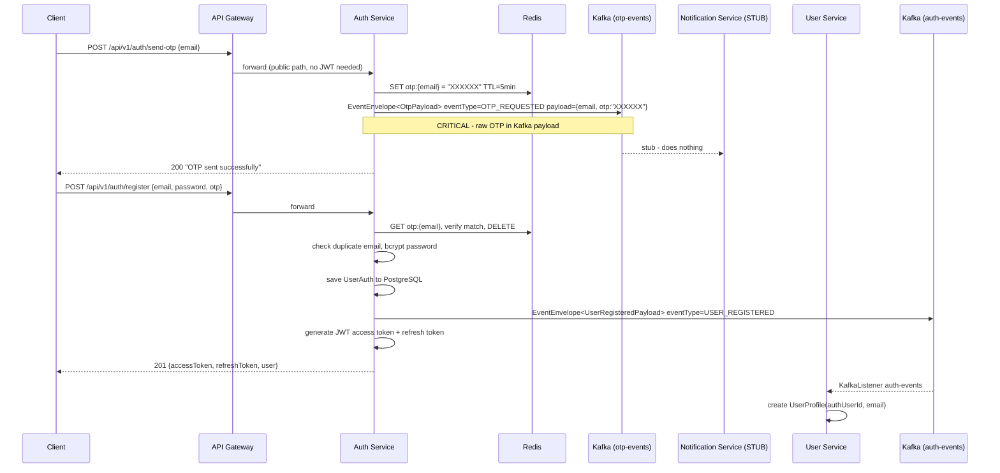
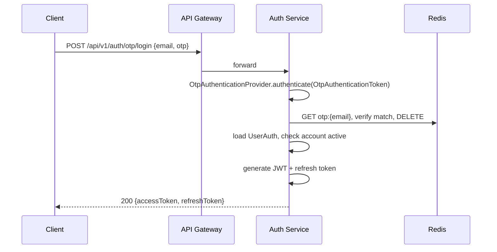
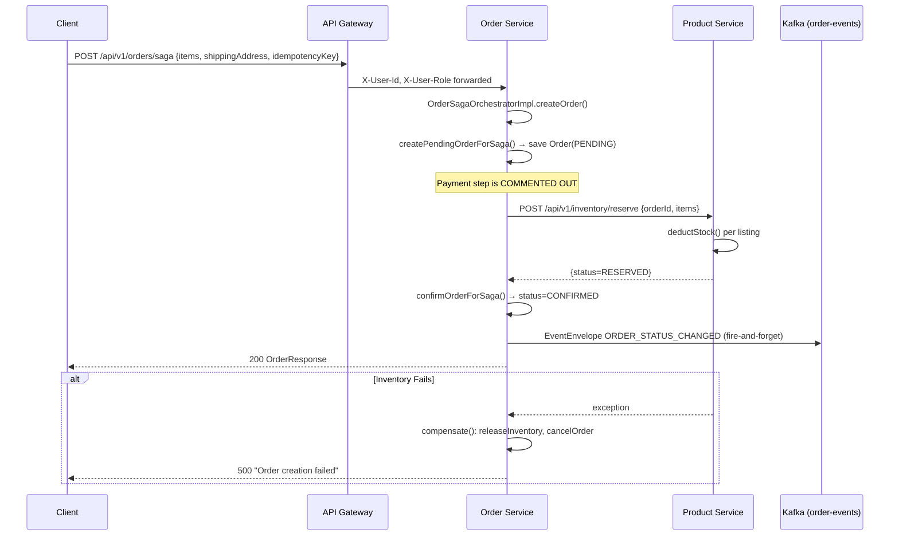
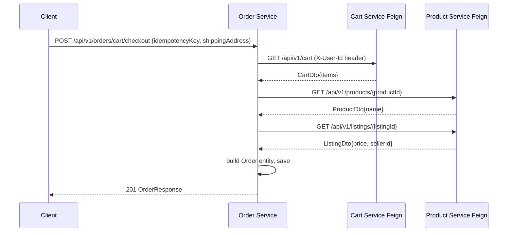
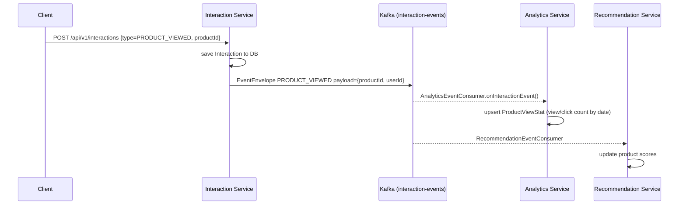
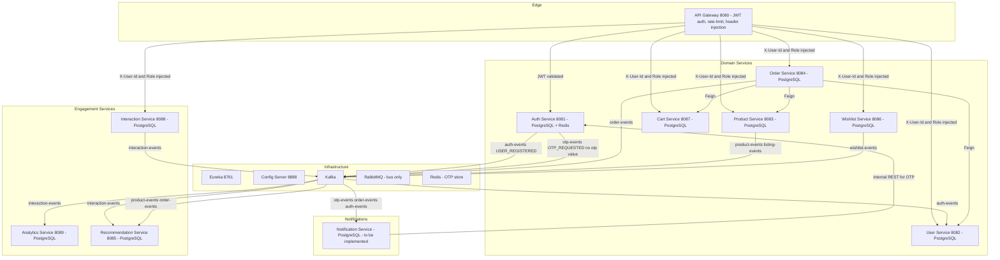

# E-Commerce Microservices Architecture Review

> **Status:** Review only — no code has been modified. Awaiting approval before any implementation.

---

## 1. Executive Summary

This is a well-structured, actively evolving Spring Boot 3.4.1 / Java 21 microservices platform. The overall direction is correct: service boundaries are sensible, JWT-based authentication at the gateway is properly implemented, Kafka is used for asynchronous domain events, and most services carry unit and integration tests. There is clear, deliberate design in several places (refresh-token rotation with SHA-256 hashing, idempotency keys on orders, saga compensation, IP+user rate-limiting at the gateway).

**The three most important problems that need to be fixed before this system is production-ready:**

1. **`OtpPayload` sends the raw OTP value over Kafka in plaintext.** The OTP is generated, stored in Redis, and *also* placed in the `payload.otp` field of an `OTP_REQUESTED` event on the `otp-events` topic. Kafka topics are durable logs. Anyone with broker read access, or who reads a dead-letter queue, obtains live OTPs. This is a **critical security vulnerability**.

2. **Kafka publish is fire-and-forget with no transactional safety.** Every service calls `kafkaTemplate.send(...)` *after* committing the database transaction. If the broker is unavailable the event is silently lost (only logged). There is no outbox, no retry, no dead-letter producer path. Domain state changes in the DB will not be reflected in downstream consumers.

3. **The notification service is a stub.** `NotificationMessageConsumer`, `NotificationServiceImpl`, `EmailServiceImpl`, `InAppNotificationServiceImpl`, `KafkaConfig`, `NotificationMessage`, `Notification`, and `NotificationController` are all empty classes. There is no actual consumer of `otp-events` or `auth-events` that delivers emails, which means OTPs are never delivered to users.

Additional high-priority issues: `EventEnvelope` is duplicated in every service; the Order Saga has commented-out payment steps; `ddl-auto: update` is used in all profiles; the `notification-service` has invalid Spring Boot 4.0.8 parent (typo); and there are no correlation IDs, distributed tracing, or structured log fields beyond basic Slf4j.

---

## 2. Repository Inventory

| Service | Port | DB | Inbound | Outbound (Kafka) | Outbound (REST) |
|---|---|---|---|---|---|
| **service-registry** | 8761 | — | — | — | — |
| **config-server** | 8888 | Git repo | — | — | — |
| **api-gateway** | 8080 | — | All client traffic | — | lb:// to downstream |
| **auth-service** | 8081 | PostgreSQL + Redis | REST | `auth-events` (USER_REGISTERED), `otp-events` (OTP_REQUESTED) | — |
| **user-service** | 8082 | PostgreSQL | REST + Kafka consumer | — | — |
| **product-service** | 8083 | PostgreSQL | REST | `product-events`, `listing-events` | — |
| **order-service** | 8084 | PostgreSQL | REST | `order-events` | ProductService (Feign), CartService (Feign), UserService (Feign) |
| **recommendation-service** | 8085 | H2 in-memory! | REST + Kafka consumer | — | — |
| **wishlist-service** | 8086 | PostgreSQL | REST | `wishlist-events` | ProductService (Feign) |
| **cart-service** | 8087 | PostgreSQL | REST | — | ProductService (Feign) |
| **interaction-service** | 8088 | PostgreSQL | REST | `interaction-events` | — |
| **analytics-service** | 8089 | PostgreSQL | REST + Kafka consumer | — | — |
| **notification-service** | ? | MySQL | (stub — empty) | — | — |

### Infrastructure Components

- **Eureka (service-registry):** All services register.
- **Spring Cloud Config Server:** Git-backed, with RabbitMQ bus for `/busrefresh`.
- **Redis:** Used by auth-service only for OTP storage (5-minute TTL).
- **RabbitMQ:** Used exclusively for Spring Cloud Bus config refresh propagation.
- **Kafka:** Event bus for async domain events across multiple services.

---

## 3. Current Data-Flow Maps

### 3.1 OTP Request + Registration Flow



> **Finding:** The OTP is never emailed because `NotificationMessageConsumer` is an empty class. The flow breaks at the notification boundary.

### 3.2 OTP Login Flow



### 3.3 Order Creation Saga



> **Key findings:** Payment is commented out. `SagaInstance` entity exists but is never used — saga state is not persisted. A JVM crash mid-saga leaves an orphaned PENDING order with deducted inventory and no recovery path.

### 3.4 Cart Checkout Flow



### 3.5 Product View and Analytics Flow



---

## 4. Findings and Risks

### CRITICAL

#### F1: OTP Plaintext in Kafka

- **File:** [`AuthServiceImpl.java`](file:///c:/backend/ecommerce/auth-service/src/main/java/com/example/auth/service/impl/AuthServiceImpl.java) — `sendOtp()` method
- **File:** [`OtpPayload.java`](file:///c:/backend/ecommerce/auth-service/src/main/java/com/example/auth/event/payload/OtpPayload.java)
- **Evidence:** `OtpPayload payload = new OtpPayload(email, otp)` — the raw `otp` string is placed in the Kafka message body and persisted in the topic log.
- **Impact:** Kafka topic retention means OTPs are accessible to anyone with broker read access, ops tooling, or dead-letter readers indefinitely.
- **Fix:** Remove the OTP from the event. Publish only `{email, notificationType}`. The OTP must remain in Redis only.

#### F2: Notification Service is an Empty Stub

- **Files:** All classes in `notification-service/src/main/java/` are empty placeholder classes with no implementation — `NotificationMessageConsumer`, `NotificationServiceImpl`, `EmailServiceImpl`, `InAppNotificationServiceImpl`, `KafkaConfig`, `NotificationMessage`, `Notification`, `NotificationController`, `NotificationService`.
- **Impact:** OTPs are never delivered. Registration confirmations and order notifications are never sent.
- **Fix:** Implement the service (see Section 7 for the recommended contract).

#### F3: Notification Service pom.xml Has Non-Existent Spring Boot Version

- **File:** [`notification-service/pom.xml`](file:///c:/backend/ecommerce/notification-service/pom.xml) line 9 — `<version>4.0.8</version>`
- **Evidence:** All other services use `3.4.1`. Spring Boot 4.0.8 does not exist. Test scope artifact IDs like `spring-boot-starter-actuator-test` are also non-existent.
- **Impact:** The notification service fails to build with Maven.
- **Fix:** Change to `3.4.1` and replace bogus test starter IDs.

---

### HIGH

#### F4: Kafka Publish is Fire-and-Forget with No Outbox

- **Files:** [`KafkaEventPublisher.java`](file:///c:/backend/ecommerce/auth-service/src/main/java/com/example/auth/event/KafkaEventPublisher.java), [`KafkaOrderEventPublisher.java`](file:///c:/backend/ecommerce/order-service/src/main/java/com/example/order/event/impl/KafkaOrderEventPublisher.java), `KafkaProductEventPublisher.java`, `KafkaWishlistEventPublisher.java`
- **Evidence:** All publishers use `kafkaTemplate.send(...)` in a `try-catch` that only logs on failure. The DB transaction commits before the Kafka send. There is no transactional outbox.
- **Impact:** If the Kafka broker is unavailable at the moment of an order creation or user registration, the event is permanently lost. The user-service never creates the profile; OTPs are never delivered.
- **Fix (phased):** Short term — add `acks=all` and `retries=3`. Medium term — implement transactional outbox for auth-service and order-service.

#### F5: `ddl-auto: update` in All Environment Configs

- **Files:** All `config-repo/*-dev.yml` — `spring.jpa.hibernate.ddl-auto: update`
- **Impact:** Auto-alters DB schema at startup, silently breaks data in shared environments, and prevents controlled schema evolution.
- **Fix:** Adopt Flyway or Liquibase. Analytics-service already declares Flyway in its pom — use it as the reference.

#### F6: Saga State Not Persisted — No Recovery from Mid-Saga Failures

- **File:** [`OrderSagaOrchestratorImpl.java`](file:///c:/backend/ecommerce/order-service/src/main/java/com/example/order/saga/service/impl/OrderSagaOrchestratorImpl.java)
- **Evidence:** `SagaInstance` entity, `SagaStatus`, `SagaStep` enums, and `SagaInstanceRepository` exist but are never referenced by the orchestrator. A JVM crash after inventory deduction but before `confirmOrderForSaga()` leaves inventory permanently deducted with no recovery.
- **Fix:** Use the existing `SagaInstance` table to checkpoint saga steps.

#### F7: Payment Integration is Commented Out

- **File:** [`OrderSagaOrchestratorImpl.java`](file:///c:/backend/ecommerce/order-service/src/main/java/com/example/order/saga/service/impl/OrderSagaOrchestratorImpl.java)
- **Evidence:** `paymentClient.processPayment(...)` and `paymentClient.refundPayment(...)` are commented out. No payment service exists in the repository.
- **Impact:** Orders are confirmed without payment. This is a known gap requiring a decision.

#### F8: Recommendation Service Uses H2 In-Memory Database

- **File:** [`config-repo/recommendation-service-dev.yml`](file:///c:/backend/ecommerce/config-repo/recommendation-service-dev.yml)
- **Evidence:** `url: jdbc:h2:mem:recommendation_db` — all recommendation data is lost on restart.
- **Fix:** Switch to PostgreSQL.

#### F9: No Service-to-Service Authentication

- **Files:** [`GatewayHeaderFilter.java`](file:///c:/backend/ecommerce/api-gateway/src/main/java/com/gateway/api_gateway/filter/GatewayHeaderFilter.java), all downstream controllers
- **Evidence:** Downstream services trust `X-User-Id` / `X-User-Role` headers unconditionally. Any process on the internal network can forge these headers by bypassing the gateway. No mTLS or service tokens are in place.

---

### MEDIUM

#### F10: `EventEnvelope<T>` is Duplicated Across 5 Services

- **Files:** Four separate copies in auth, order, product, and wishlist services. Auth-service is missing the `static of()` factory present in the others.
- **Impact:** Any enhancement (e.g., adding `correlationId`) requires changes in multiple places; divergence has already started.

#### F11: Kafka Consumers Deserialize to `Map<?,?>` with Manual String Extraction

- **Files:** [`UserEventConsumerImpl.java`](file:///c:/backend/ecommerce/user-service/src/main/java/com/example/user/event/UserEventConsumerImpl.java), [`AnalyticsEventConsumer.java`](file:///c:/backend/ecommerce/analytics-service/src/main/java/com/example/analytics/consumer/AnalyticsEventConsumer.java)
- **Evidence:** `payload.get("userId").toString()` — a field rename in the producer silently breaks the consumer with no compile-time warning.

#### F12: Inconsistent Error Response Structures

- Auth-service returns `{status, message, validationErrors}`.
- Analytics-service returns `{timestamp, status, error, message, details}`.
- `sendOtp()` returns a raw `String` rather than a structured response.
- `loginWithOtp()` returns `AuthResponse` directly without `ResponseEntity` wrapping (unlike all other auth endpoints).

#### F13: No Correlation IDs or Distributed Tracing

- No `X-Correlation-Id` propagation. No Micrometer tracing configured. Logs from different services for the same request cannot be correlated.

#### F14: `spring.json.trusted.packages: "*"` on All Kafka Consumers

- **Files:** All `config-repo/*-dev.yml` Kafka consumer configs.
- **Fix:** Restrict to `com.example.*` to prevent deserialization gadget attacks.

#### F15: `OtpLoginRequest` Missing `@Valid`

- **File:** [`AuthController.java`](file:///c:/backend/ecommerce/auth-service/src/main/java/com/example/auth/controller/AuthController.java) — `loginWithOtp()` uses `@RequestBody OtpLoginRequest request` without `@Valid`. All other endpoints use `@Valid`.

#### F16: Analytics `resultCount` Hardcoded to `1`

- **File:** [`AnalyticsEventConsumer.java`](file:///c:/backend/ecommerce/analytics-service/src/main/java/com/example/analytics/consumer/AnalyticsEventConsumer.java) line 55 — `resultCount(1)` is hardcoded when consuming `SEARCH_PERFORMED` events.

#### F17: `UserEventConsumerImpl` Does Not Filter on `eventType`

- **File:** [`UserEventConsumerImpl.java`](file:///c:/backend/ecommerce/user-service/src/main/java/com/example/user/event/UserEventConsumerImpl.java)
- **Evidence:** The consumer processes any message on `auth-events` without checking `eventType`. Currently safe (OTP events are on `otp-events`), but fragile — should always guard with `if ("USER_REGISTERED".equals(eventType))`.

---

### LOW

#### F18: `@Transactional` on Interface Method in `AuthService`

- **File:** [`AuthService.java`](file:///c:/backend/ecommerce/auth-service/src/main/java/com/example/auth/service/AuthService.java) — redundant `@Transactional` on the interface method; the implementation already has it.

#### F19: `AtomicLong` Order Sequence Counter Resets on Restart

- **File:** [`OrderServiceImpl.java`](file:///c:/backend/ecommerce/order-service/src/main/java/com/example/order/service/impl/OrderServiceImpl.java) — `private final AtomicLong orderSequence = new AtomicLong(...)` resets on every restart and is not shared across replicas.
- **Fix:** Use a PostgreSQL sequence or format order numbers from UUID.

#### F20: What Is Good and Should Not Change

The following are well-implemented and should be preserved:
- **Refresh token rotation with SHA-256 hashing** in `RefreshTokenServiceImpl` — secure, revocation-aware, replay-detected.
- **JWT sanitization at the gateway** in `JwtAuthenticationWebFilter` — upstream `X-User-*` headers are stripped before JWT parsing.
- **Idempotency key handling** in `OrderServiceImpl.createOrder()` — returns the existing order on duplicate key.
- **OTP stored in Redis with TTL** in `OtpServiceImpl` — correct. The problem is only the Kafka publication of the OTP value.
- **Integration test coverage** in `AuthControllerIntegrationTest` — full happy-path and error-path coverage.
- **`@Primary` + logging fallback publishers** — `LoggingOrderEventPublisher` / `LoggingWishlistEventPublisher` for non-Kafka profiles is a nice pattern.

---

## 5. Contract Analysis

### 5.1 `EventEnvelope<T>` — Current State

```java
// auth-service version (missing static factory)
public record EventEnvelope<T>(
    UUID eventId,
    String eventType,
    int eventVersion,
    Instant occurredAt,
    T payload
) {}

// order, product, wishlist versions (adds static factory)
public static <T> EventEnvelope<T> of(String eventType, T payload) {
    return new EventEnvelope<>(UUID.randomUUID(), eventType, 1, Instant.now(), payload);
}
```

**Missing from all versions:** `correlationId`, `causationId`, `producerService`. Consumers currently ignore `eventType` (user-service) or must extract it manually from the `Map`.

### 5.2 OTP Payload — Security Problem

```java
// CURRENT — must be changed
public class OtpPayload {
    private String email;
    private String otp;    // raw OTP in plaintext Kafka log — REMOVE THIS
}

// RECOMMENDED
public record OtpNotificationRequested(
    String email,
    String notificationType  // "REGISTRATION_OTP" or "LOGIN_OTP"
    // No otp field
) {}
```

### 5.3 `UserRegisteredPayload` — Good, Keep As-Is

```java
public record UserRegisteredPayload(UUID userId, String email, String role) {}
```

Clean, sufficient, and typed. Acceptable without changes.

### 5.4 Order/Product/Wishlist Payloads — Untyped Map

```java
// CURRENT — type-unsafe
Map<String, Object> payload = new HashMap<>();
payload.put("orderId", order.getId());
send(key, EventEnvelope.of("ORDER_CREATED", payload));
```

Unlike auth-service which uses typed records, the remaining services use `Map<String, Object>`. A field rename causes silent consumer breakage.

### 5.5 REST Error Response Formats (Verified Differences)

| Service | Format |
|---|---|
| auth-service | `{status, message, validationErrors}` |
| analytics-service | `{timestamp, status, error, message, details}` |
| product-service | `ErrorResponse` DTO (separate class) |
| order-service | Custom format per handler |

No service wraps success responses in an additional envelope — this is correct for REST APIs and should **not** be changed.

---

## 6. Architecture Options

### A. Shared `contracts` Maven Module

Extract `EventEnvelope`, common payload records, and a shared error response contract into `ecommerce-event-contracts`.

**Pros:** Single definition, compile-time correctness, visible schema evolution.  
**Cons:** All services take a build dependency. A breaking change forces simultaneous updates. Risk of internal DTOs leaking across service boundaries.  
**Verdict:** Justified for `EventEnvelope<T>` and shared event payload records only. Internal service DTOs must not be shared.

### B. Each Service Owns Payload, Shared Envelope Only

Keep payload record classes local to each producer. Extract only `EventEnvelope<T>` to a shared module. Consumers define their own mirror classes.

**Pros:** Minimal coupling. Producer changes don't force consumer recompilation.  
**Cons:** Silent consumer breakage on field renames.  
**Verdict:** Best option at current scale. Pair with a published event schema document.

### C. Status Quo

**Pros:** No migration effort.  
**Cons:** Divergence is already happening (auth-service missing the `of()` factory). Technical debt accumulates.  
**Verdict:** Not recommended.

### Business Events vs. Notification Requests

**Recommended approach — Hybrid:**
- Keep `USER_REGISTERED`, `ORDER_CREATED`, `ORDER_STATUS_CHANGED` as pure business domain events. Notification-service subscribes and handles delivery decisions.
- For OTP: Remove the OTP from Kafka entirely. Auth-service sends `OTP_REQUESTED{email, notificationType}` (no OTP value). Notification-service receives the event and calls a secured internal auth-service endpoint `GET /internal/otp/{email}` (service-account token, short TTL, one-time read) to obtain the OTP for email rendering. Alternatively, auth-service calls the notification-service's REST API synchronously before returning — this eliminates the race window entirely at the cost of synchronous coupling.

---

## 7. Recommended Target Architecture

### Component Diagram



### Key Design Decisions for Target State

1. **OTP never leaves auth-service via Kafka.** Publish only `{email, notificationType}`. Notification-service fetches the OTP value through a secured internal endpoint protected by a service account header or a short-lived one-time token.

2. **Shared `ecommerce-event-contracts` module** with `EventEnvelope<T>` enhanced as below, plus typed payload records for `UserRegisteredPayload`, `OtpNotificationRequested`, `OrderCreatedPayload`, `OrderStatusChangedPayload`. Internal DTOs stay in each service.

3. **Enhanced `EventEnvelope`:**

```java
public record EventEnvelope<T>(
    UUID eventId,
    String eventType,
    int eventVersion,
    Instant occurredAt,
    String producerService,
    UUID correlationId,
    T payload
) {
    public static <T> EventEnvelope<T> of(
            String eventType, String producerService, UUID correlationId, T payload) {
        return new EventEnvelope<>(
            UUID.randomUUID(), eventType, 1, Instant.now(),
            producerService, correlationId, payload);
    }
}
```

4. **Transactional outbox for auth-service and order-service.** These are the two services where event loss has the highest impact (user profiles not created, order events not dispatched).

5. **`SagaInstance` checkpointing in `OrderSagaOrchestratorImpl`.** Persist `{orderId, step=INVENTORY_RESERVED, status=IN_PROGRESS}` before calling product-service, and `{step=COMPLETED}` after confirmation. A recovery scheduler marks stale sagas `FAILED` and calls compensation.

6. **Replace `ddl-auto: update` with Flyway.** Start with analytics-service (Flyway already in pom) and auth-service.

7. **Notification service implementation contract:**
   - Consumer for `otp-events`: fetch OTP via internal auth-service endpoint, send email. Do **not** create an in-app notification for OTPs.
   - Consumer for `auth-events` (USER_REGISTERED): send welcome email using `email` from payload.
   - Consumer for `order-events` (ORDER_CREATED, ORDER_STATUS_CHANGED): send confirmation/status email and create in-app notification record (linked to `authUserId`).
   - DB: switch to PostgreSQL to match the rest of the platform.

8. **Switch recommendation-service to PostgreSQL.** H2 in-memory is unsuitable for any persistent domain data.

---

## 8. Migration Roadmap

### Stage 0: Security Fixes (1–2 days, do immediately)

| Item | Files | Change |
|---|---|---|
| Remove OTP from Kafka payload | [`OtpPayload.java`](file:///c:/backend/ecommerce/auth-service/src/main/java/com/example/auth/event/payload/OtpPayload.java), [`AuthServiceImpl.java`](file:///c:/backend/ecommerce/auth-service/src/main/java/com/example/auth/service/impl/AuthServiceImpl.java) | Replace `OtpPayload(email, otp)` with `OtpNotificationRequested(email, notificationType)` |

**Acceptance:** Grep for OTP value in any Kafka message or log — result is empty.

### Stage 1: Fix Notification Service Build (1 day)

| Item | Files | Change |
|---|---|---|
| Fix pom.xml | [`notification-service/pom.xml`](file:///c:/backend/ecommerce/notification-service/pom.xml) | Change parent to `3.4.1`, remove non-existent test starters |
| Fix MySQL vs PostgreSQL | `pom.xml` | Decide on DB (see open question 3) |
| Implement Kafka consumer | `NotificationMessageConsumer.java` | Listen to `otp-events`, call auth internal endpoint, send email via Spring Mail |

**Acceptance:** Service starts and builds. OTP email delivered in smoke test.

### Stage 2: Unified `EventEnvelope` Module (2–3 days)

| Item | Files | Change |
|---|---|---|
| Create shared module | New `ecommerce-event-contracts/pom.xml` | Single canonical `EventEnvelope<T>` with `correlationId` and `producerService` |
| Add `correlationId` to gateway | [`JwtAuthenticationWebFilter.java`](file:///c:/backend/ecommerce/api-gateway/src/main/java/com/gateway/api_gateway/filter/JwtAuthenticationWebFilter.java) | Generate or propagate `X-Correlation-Id` |
| Migrate auth-service | `KafkaEventPublisher.java` | Use shared module, add `of()` factory |
| Migrate order-service | `KafkaOrderEventPublisher.java` | Use shared module |

**Risk:** Consumers seeing new fields as `null` — backward compatible with Jackson.  
**Acceptance:** `correlationId` appears in producer and consumer logs for the same event.

### Stage 3: Typed Kafka Payloads for Order/Product/Wishlist (3–4 days)

| Item | Change |
|---|---|
| Define payload records | `OrderCreatedPayload`, `OrderStatusChangedPayload`, `ProductCreatedPayload` etc. in shared module |
| Update publishers | Replace `Map<String, Object>` with typed records in `KafkaOrderEventPublisher`, `KafkaProductEventPublisher`, `KafkaWishlistEventPublisher` |
| Update consumers | Use typed DTOs in `AnalyticsEventConsumer`, `RecommendationEventConsumer` |

**Acceptance:** All consumers compile against typed classes with no `Map` extraction.

### Stage 4: Producer Reliability (1 week)

| Item | Files | Change |
|---|---|---|
| Producer config hardening | All `config-repo/*-dev.yml` | Add `acks=all`, `retries=3`, `enable.idempotence=true`, exponential backoff |
| Transactional outbox for auth-service | New `OutboxEvent` entity, scheduler | Save event to DB in same transaction; poll and publish |
| Transactional outbox for order-service | New `OutboxEvent` entity, scheduler | Same pattern |

**Acceptance:** Kill Kafka broker mid-registration, restart broker, confirm `USER_REGISTERED` is eventually published and user profile is created.

### Stage 5: Saga State Persistence (1 week)

| Item | Files | Change |
|---|---|---|
| Wire `SagaInstance` | [`OrderSagaOrchestratorImpl.java`](file:///c:/backend/ecommerce/order-service/src/main/java/com/example/order/saga/service/impl/OrderSagaOrchestratorImpl.java), [`SagaInstanceRepository.java`](file:///c:/backend/ecommerce/order-service/src/main/java/com/example/order/saga/repository/SagaInstanceRepository.java) | Save saga step at each transition |
| Recovery scheduler | New `SagaRecoveryScheduler` | Find sagas stuck in `IN_PROGRESS` for > N minutes; run compensation |

**Acceptance:** Kill JVM after inventory reservation, confirm order is eventually cancelled and inventory released.

### Stage 6: Consistent Error Responses + Correlation IDs (3–4 days)

| Item | Change |
|---|---|
| Shared error response DTO | Define `ApiErrorResponse{status, message, traceId, validationErrors, timestamp}` |
| Update all `GlobalExceptionHandler` | Use the shared format |
| Add `@Valid` to `loginWithOtp()` | `AuthController.java` |
| Add Micrometer tracing | Zipkin or OTLP exporter; MDC `traceId` in all logs |

**Acceptance:** Single error schema across all services. `traceId` in logs and error responses.

### Stage 7: Database Migration Safety (ongoing, start with analytics-service)

| Item | Change |
|---|---|
| Add Flyway migrations | `V1__initial_schema.sql` per service |
| Change `ddl-auto` | `validate` in all configs |

### Stage 8: Recommendation Service — PostgreSQL (1 day)

| Item | Files | Change |
|---|---|---|
| Switch DB | `config-repo/recommendation-service-dev.yml`, `pom.xml` | Replace H2 with PostgreSQL; add Flyway migration |

---

## 9. Open Questions

1. **OTP delivery mechanism:** Should notification-service call a secured internal auth-service endpoint to fetch the OTP, or should auth-service call notification-service's REST API synchronously before returning the `sendOtp` response? The async Kafka approach is appropriate for business events but creates a timing window for OTPs.

2. **Payment service:** Is a payment service planned? The `PaymentClient` interface exists in order-service and the saga has commented-out payment steps. Should this be unblocked or remain deferred?

3. **Notification service database:** Every other service uses PostgreSQL. `notification-service/pom.xml` declares `mysql-connector-j`. Is this intentional or a copy-paste artifact? Recommending PostgreSQL to stay consistent.

4. **In-app notification for OTPs:** Should OTP notifications appear in a user's in-app notification feed? During registration, the user does not yet exist in user-service. Recommend: no in-app record for OTPs, only for post-registration events (orders, account updates).

5. **Service-to-service authentication:** Is there a plan for mTLS or service tokens to protect internal endpoints from forged `X-User-*` headers if a service port is accidentally exposed? This determines the design of the notification-service internal OTP endpoint.

---

## 10. Implementation Readiness

### Ready to Implement Now (no clarification needed)

- ✅ Fix `notification-service/pom.xml` Spring Boot version to `3.4.1`
- ✅ Remove OTP from `OtpPayload` / `AuthServiceImpl.sendOtp()`
- ✅ Add `@Valid` to `AuthController.loginWithOtp()`
- ✅ Add `eventType` guard to `UserEventConsumerImpl`
- ✅ Fix `AtomicLong` order sequence — use DB sequence
- ✅ Add `acks=all` and `retries=3` to Kafka producer configs
- ✅ Switch recommendation-service from H2 to PostgreSQL
- ✅ Unify `EventEnvelope` (add `of()` factory to auth-service; consolidate into one copy)
- ✅ Restrict `trusted.packages` from `"*"` to `"com.example.*"`

### Requires Your Decision Before Implementation

- ⏳ OTP delivery mechanism (question 1)
- ⏳ Shared contracts module scope — which payloads go in it
- ⏳ Payment service timeline (affects saga completion)
- ⏳ Notification service DB choice (question 3)
- ⏳ In-app notification design for OTPs (question 4)
