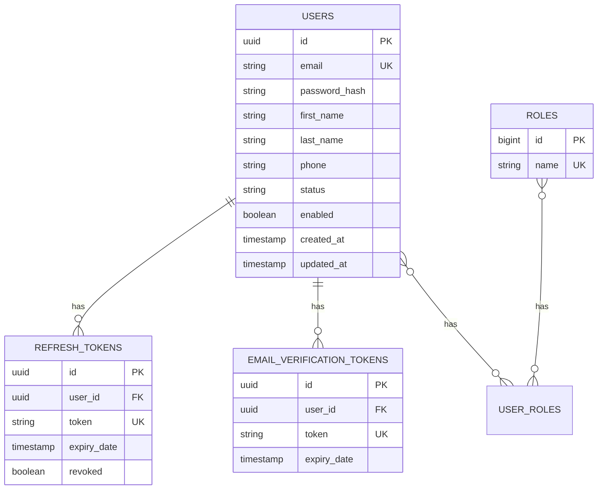

# Auth Service

[](https://www.oracle.com/java/)
[](https://spring.io/projects/spring-boot)
[](https://www.postgresql.org/)
[](https://flywaydb.org/)
[](https://kafka.apache.org/)

Identity and Access Management (IAM) microservice responsible for customer registration, seller onboarding with moderation workflows, multi-channel authentication (password + OTP), JWT token lifecycle management, and post-commit event publication.

---

## 1. Architectural Highlights

- **Dual Authentication Mechanism**:
  - **Standard Credentials**: Email + password with salt-hashed BCrypt storage.
  - **Passwordless OTP**: 6-digit cryptographic OTP cached in Redis with a 5-minute TTL and rate-limited dispatch. Supports dual endpoint aliasing (`/send-otp` and `/otp/send`) for frontend resilience.
- **Marketplace Seller Lifecycle**:
  - Sellers register via `/api/v1/auth/register-seller` in an initial `PENDING_APPROVAL` status.
  - Platform administrators review, approve, or reject seller accounts via dedicated moderation endpoints (`/sellers/{id}/approve`, `/reject`).
- **Post-Commit Event Guarantees**:
  - Uses Spring's `TransactionSynchronizationManager.registerSynchronization(afterCommit)` so that `USER_REGISTERED`, `SELLER_REGISTERED`, and `OTP_REQUESTED` events publish to Kafka **only after** the database commit succeeds.
- **Database-per-Service & Flyway**:
  - Database: `ecommerce_auth_db`
  - Automated migration via Flyway (`V1__init_auth_schema.sql`).
  - Hibernate schema validation enabled (`ddl-auto: validate`).

---

## 2. Database Schema (Flyway V1)



---

## 3. REST API Reference

| Method | Endpoint | Access Level | Description |
|---|---|---|---|
| `POST` | `/api/v1/auth/register` | Public | Register customer account with verified email OTP |
| `POST` | `/api/v1/auth/register-seller` | Public | Register seller account (created in `PENDING_APPROVAL` status) |
| `POST` | `/api/v1/auth/login` | Public | Standard login returning access token & refresh token |
| `POST` | `/api/v1/auth/otp/send` | Public | Generate and send 6-digit OTP code to email via Kafka |
| `POST` | `/api/v1/auth/otp/login` | Public | Verify OTP and authenticate user |
| `POST` | `/api/v1/auth/refresh` | Public | Issue new access token using a valid refresh token |
| `POST` | `/api/v1/auth/logout` | Authenticated | Revoke refresh token and invalidate active session |
| `GET` | `/api/v1/auth/sellers/pending` | `ROLE_ADMIN` | List all seller applications pending review |
| `POST` | `/api/v1/auth/sellers/{id}/approve` | `ROLE_ADMIN` | Approve seller account and dispatch `SELLER_APPROVED` event |
| `POST` | `/api/v1/auth/sellers/{id}/reject` | `ROLE_ADMIN` | Reject seller application with reason |

---

## 4. Kafka Event Contracts

### Published Topics

1. **`otp-events`** (`OtpRequestedEvent`):
   ```json
   {
     "email": "user@example.com",
     "otp": "492810",
     "expirationMinutes": 5,
     "timestamp": "2026-10-18T01:00:00Z"
   }
   ```
2. **`auth-events`** (`UserRegisteredEvent` / `SellerRegisteredEvent`):
   ```json
   {
     "userId": "d3b07384-d113-4e4b-9c8e-4a6c8e3b7b21",
     "email": "customer@example.com",
     "role": "ROLE_CUSTOMER",
     "firstName": "Sahil",
     "lastName": "Kumar",
     "timestamp": "2026-10-18T01:00:00Z"
   }
   ```

---

## 5. Environment Variables & Configuration

| Variable | Default Value | Description |
|---|---|---|
| `SERVER_PORT` | `8081` | Service HTTP port |
| `POSTGRES_HOST` | `localhost` | PostgreSQL host |
| `POSTGRES_PORT` | `5432` | PostgreSQL port |
| `POSTGRES_USERNAME`| `postgres` | Database username |
| `POSTGRES_PASSWORD`| *(required)* | Database password |
| `REDIS_HOST` | `localhost` | Redis host for OTP & token cache |
| `REDIS_PORT` | `6379` | Redis port |
| `KAFKA_BOOTSTRAP_SERVERS` | `localhost:9092` | Kafka broker connection string |
| `JWT_SECRET_KEY` | *(Config Server)* | 256-bit secret key for HMAC-SHA256 tokens |
| `JWT_ACCESS_TOKEN_EXPIRATION_MS` | `900000` (15 min) | Access token lifetime |
| `JWT_REFRESH_TOKEN_EXPIRATION_MS` | `604800000` (7 days)| Refresh token lifetime |

---

## 6. Local Development

```bash
# Build and run
mvn clean spring-boot:run

# Execute tests
mvn test
```
