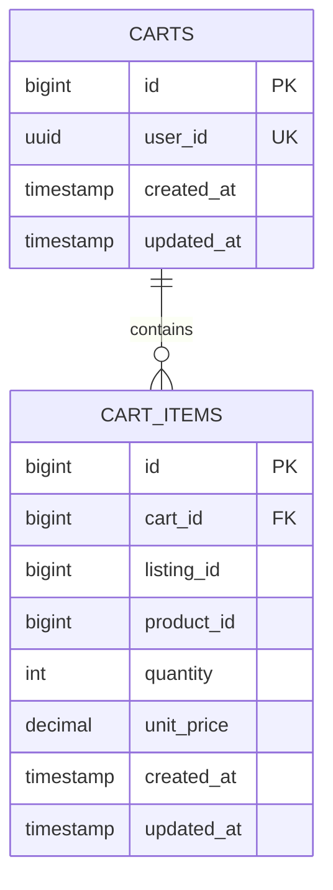

# Cart Service

[](https://www.oracle.com/java/)
[](https://spring.io/projects/spring-boot)
[](https://www.postgresql.org/)
[](https://flywaydb.org/)
[](https://redis.io/)

High-performance shopping cart microservice backed by Redis and PostgreSQL. Coordinates real-time price lookups, item quantity mutations, product metadata enrichment, and inventory validation with `product-service`.

---

## 1. Architectural Highlights

- **Dual-Layer Persistence**:
  - Leverages Redis for ultra-low latency cart reads and transient customer session updates.
  - Asynchronously/durably persists cart data to PostgreSQL (`ecommerce_cart_db`).
- **Real-Time Catalog Enrichment**:
  - Enriches cart items with current `productName`, `unitPrice`, and `stock` from `product-service` via OpenFeign.
- **Flexible Identifier Lookup**:
  - Supports updating and removing cart items by either internal `itemId` OR marketplace `listingId`/`productId`.
- **Post-Commit Event Publishing**:
  - Publishes `CART_UPDATED` and `CART_CLEARED` to Kafka topic `cart-events` after transaction commit.

---

## 2. Database Schema (Flyway V1)



---

## 3. REST API Reference

| Method | Endpoint | Access Level | Description |
|---|---|---|---|
| `GET` | `/api/v1/cart` | Authenticated | Retrieve customer's active cart with enriched product details |
| `POST` | `/api/v1/cart/items` | Authenticated | Add product listing to cart with specified quantity |
| `PUT` | `/api/v1/cart/items/{id}` | Authenticated | Update item quantity (accepts `itemId` or `listingId`) |
| `DELETE` | `/api/v1/cart/items/{id}` | Authenticated | Remove item from cart (accepts `itemId` or `listingId`) |
| `DELETE` | `/api/v1/cart` | Authenticated | Clear all items from the active cart |

---

## 4. Environment Variables & Configuration

| Variable | Default Value | Description |
|---|---|---|
| `SERVER_PORT` | `8087` | Service HTTP port |
| `POSTGRES_HOST` | `localhost` | PostgreSQL host |
| `POSTGRES_PORT` | `5432` | PostgreSQL port |
| `POSTGRES_USERNAME`| `postgres` | Database username |
| `POSTGRES_PASSWORD`| *(required)* | Database password |
| `REDIS_HOST` | `localhost` | Redis host for session caching |
| `REDIS_PORT` | `6379` | Redis port |
| `KAFKA_BOOTSTRAP_SERVERS` | `localhost:9092` | Kafka broker connection string |
| `EUREKA_SERVER_URL` | `http://localhost:8761/eureka/` | Eureka Service Registry endpoint |

---

## 5. Local Development

```bash
mvn clean spring-boot:run
```
