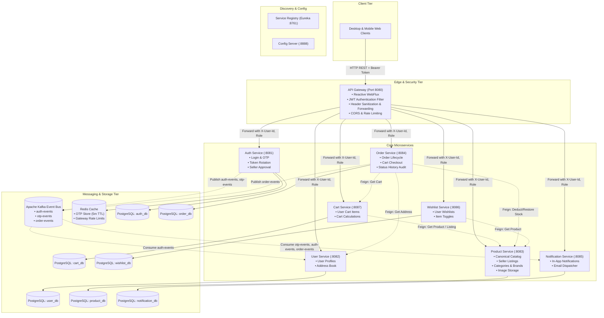
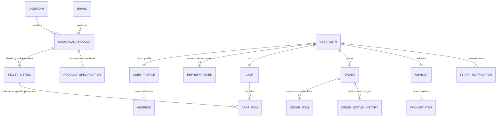
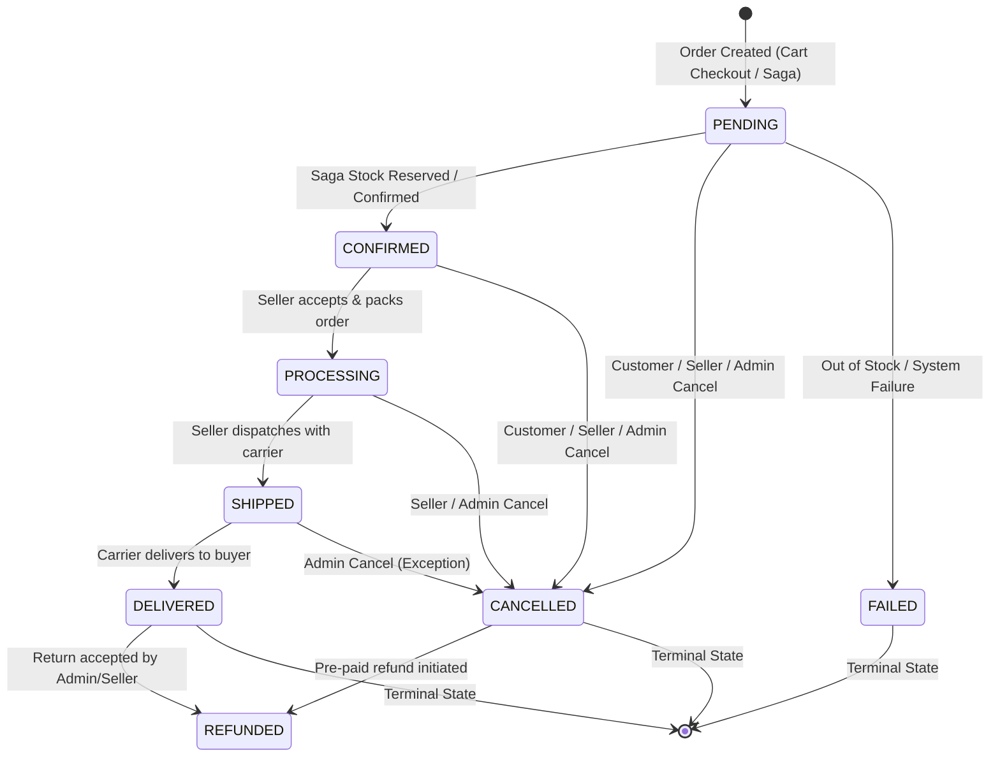
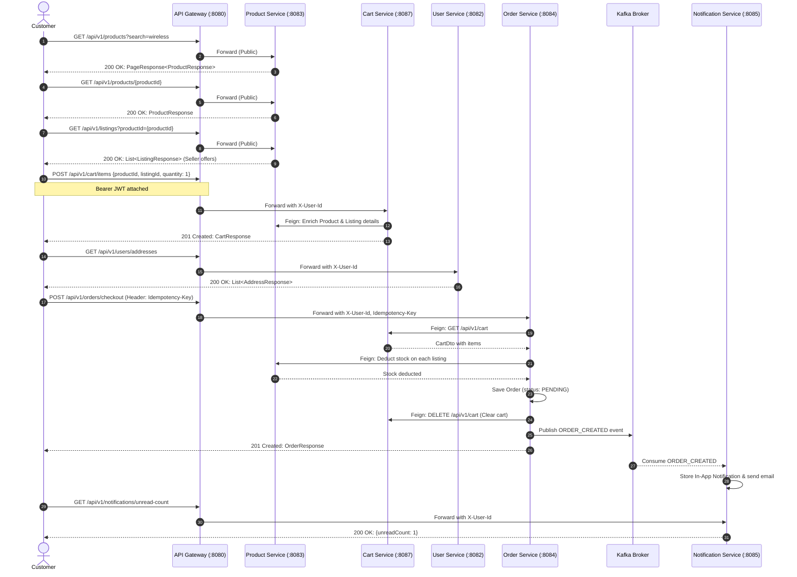
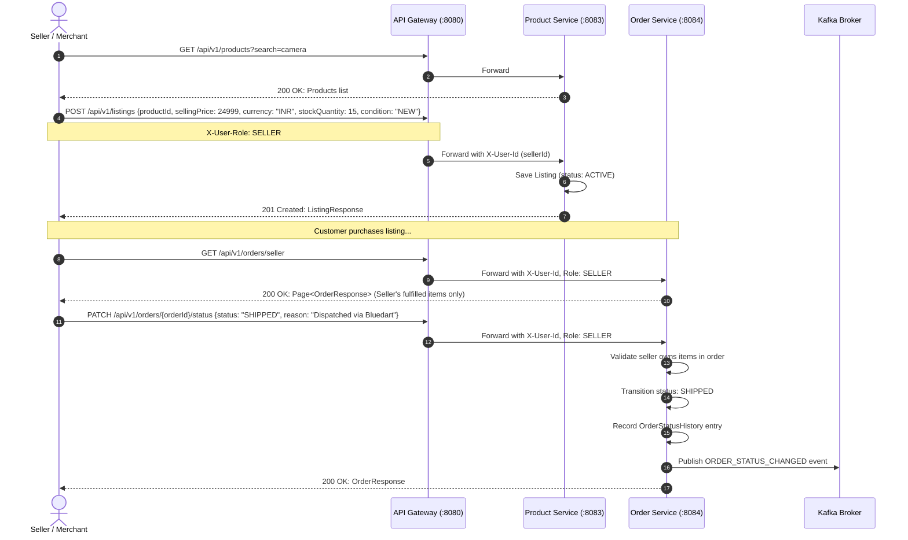

# E-Commerce Backend Reverse-Engineering & UI/UX Specification for Google Stitch

> **Document Type:** Production Architecture Analysis & UI/UX Design Specification  
> **Target Audience:** Google Stitch, Product Designers, Frontend Engineers, Solution Architects  
> **Codebase Analyzed:** `c:\backend\ecommerce` (Java 21, Spring Boot 3.4.1, Spring Cloud Gateway, Netflix Eureka, Apache Kafka, PostgreSQL, Redis)  
> **Status:** Ground-Truth Verified Against Active Microservice Implementations

---

## Deliverable 1: Executive Overview

This application is an enterprise-grade, multi-tenant, multi-role e-commerce marketplace built on Spring Boot 3.4.1 and Spring Cloud 2024.0.0. The architecture cleanly separates the canonical product catalog from merchant-specific inventory offers:

1. **Canonical Catalog vs. Marketplace Listings:**
   - **Canonical Products** are managed strictly by **Platform Administrators** (`ROLE_ADMIN`). They define product definitions (title, description, brand, category, tags, key-value specifications, and catalog images). Canonical products carry no price or inventory themselves.
   - **Listings** are created and priced by **Merchants/Sellers** (`ROLE_SELLER` or `ROLE_ADMIN`). A listing associates a seller with a canonical product, defining selling price, currency, stock quantity, item condition (`NEW`, `REFURBISHED`, `USED_LIKE_NEW`, `USED_GOOD`, `USED_FAIR`), and listing status (`ACTIVE`, `INACTIVE`, `OUT_OF_STOCK`).
   - Customers discover canonical products and select from competitive seller listings to add items to their cart.

2. **Verified Roles & User Personas:**
   - **Guest / Public:** Unauthenticated visitor browsing the landing page, product catalog, search results, category/brand filters, and product details.
   - **Customer (`ROLE_USER`):** Authenticated shopper with active account status. Can maintain a server-side shopping cart, check out with saved or custom delivery addresses, place idempotent orders, cancel orders in early states, maintain a persistent wishlist, manage an address book, view and update profile details, and receive real-time in-app notifications.
   - **Merchant / Seller (`ROLE_SELLER`):** Onboards via a specialized seller registration endpoint that places the account in `PENDING_APPROVAL` status. Once approved by an Administrator, the seller gains access to a dedicated Seller Workspace (`/seller`) to manage inventory listings, track stock levels, inspect customer orders containing their items, and advance order fulfillment states (`PROCESSING`, `SHIPPED`, `DELIVERED`, `CANCELLED`).
   - **Platform Administrator (`ROLE_ADMIN`):** Possesses overarching platform authority. Accesses the Admin Control Center (`/admin`) to manage the canonical catalog, create/edit categories and brands, inspect all orders across all buyers/sellers, force order status overrides, approve or reject pending seller applications, and modify user roles.

3. **Explicit Project Scope Exclusions:**
   - Per explicit architectural requirements, legacy or experimental recommendation algorithms (`recommendation-service`), clickstream tracking (`interaction-service`), and analytics aggregators (`analytics-service`) are excluded from current implementation and frontend designs.

---

## Deliverable 2: Backend Architecture

### 2.1 Microservices Inventory

| Microservice | Internal Port | Primary Database | Exposed Path Prefix (Gateway Route) | Key Responsibilities & Capabilities |
| :--- | :--- | :--- | :--- | :--- |
| **api-gateway** | `8080` | — | All inbound traffic (`/**`) | Spring Cloud Gateway (Reactive WebFlux). Validates JWT, strips client-supplied identity headers, extracts user claims (`userId`, `email`, `role`), sets downstream forwarding headers (`X-User-Id`, `X-User-Role`, `X-User-Email`), enforces CORS and Redis rate-limiting. |
| **auth-service** | `8081` | PostgreSQL + Redis | `/api/v1/auth/**` | User authentication, password encryption (BCrypt), OTP generation and Redis storage (5-min TTL), customer and seller registration, JWT issuance and refresh-token rotation, `/me` profile lookup, admin seller approvals and role updates. |
| **user-service** | `8082` | PostgreSQL | `/api/v1/users/**` | Customer profile management (first name, last name, phone, avatar URL), multi-address address book CRUD, default address designation. Listens to `auth-events` Kafka topic to automatically provision user profiles upon registration. |
| **product-service** | `8083` | PostgreSQL | `/api/v1/products/**` `/api/v1/listings/**` `/api/v1/categories/**` `/api/v1/brands/**` | Canonical product catalog management, category and brand taxonomies, multipart product image storage, seller listing management, stock deduction and restoration, internal inventory reservation/release API. |
| **cart-service** | `8087` | PostgreSQL | `/api/v1/cart/**` | Persistent user shopping carts, adding items with product and listing association, quantity adjustments, item removal, cart clearing. Uses OpenFeign to enrich item details from `product-service`. |
| **order-service** | `8084` | PostgreSQL | `/api/v1/orders/**` | Order creation via direct checkout or cart checkout, atomic stock deduction, idempotency key enforcement, customer order history and order details, order cancellation (customer states: `PENDING`, `CONFIRMED`), status history audit log, admin and seller order tracking and status transitions. |
| **wishlist-service**| `8086` | PostgreSQL | `/api/v1/wishlist/**` | Customer wishlists, add/remove product items, wishlist status checking. Uses OpenFeign to enrich product name and canonical image URL from `product-service`. |
| **notification-service** | `8085` | PostgreSQL / MySQL | `/api/v1/notifications/**` | Multi-channel notification engine. Listens to Kafka topics `otp-events`, `auth-events`, `order-events`. Dispatches emails and stores in-app notifications. Exposes notification inbox, unread counts, and read/read-all endpoints. |
| **service-registry**| `8761` | — | Internal | Netflix Eureka Server for dynamic service registration and client-side load balancing (`lb://`). |
| **config-server** | `8888` | Git Repo / Local | Internal | Centralized Spring Cloud Config Server backed by configuration repository and RabbitMQ bus. |

### 2.2 System Architecture Diagram

### 2.3 Gateway Routing, Authentication & Security Model

1. **Header Sanitization & Injection:**
   - Downstream services trust `X-User-Id`, `X-User-Role`, and `X-User-Email` headers.
   - To prevent spoofing, `JwtAuthenticationWebFilter.java` removes any incoming client headers matching `X-User-Id`, `X-User-Role`, `X-User-Email`, and `X-User-Name`.
   - If an `Authorization: Bearer <token>` header is present, the gateway parses and verifies the HMAC-SHA256 signature, extracts claims (`userId`, `role`, `sub`), and injects sanitized `X-User-Id`, `X-User-Role`, and `X-User-Email` headers into the downstream request via `GatewayHeaderFilter.java`.

2. **Public vs. Protected Route Rules (Enforced at Gateway):**
   - **Permit All (Unauthenticated):**
     * All `/api/v1/auth/**` routes (except admin-specific paths requiring token).
     * `GET /api/v1/products/**` (Catalog browsing).
     * `GET /api/v1/listings/**` (Public listing prices and conditions).
     * `GET /api/v1/brands/**` and `GET /api/v1/categories/**`.
     * Actuator health checks (`/actuator/health`, `/actuator/info`).
   - **Protected Routes (Requires valid JWT):**
     * All user profile and address book operations (`/api/v1/users/**`).
     * All cart operations (`/api/v1/cart/**`).
     * All wishlist operations (`/api/v1/wishlist/**`).
     * All customer and seller order operations (`/api/v1/orders/**`).
     * All notification operations (`/api/v1/notifications/**`).
     * Non-GET catalog requests (Creating products, uploading images, creating listings).
   - **Role-Restricted Routes:**
     * `/api/v1/orders/admin/**`: Gateway explicitly enforces `hasRole('ADMIN')`.
     * `/api/v1/auth/admin/**`: Spring Security `@PreAuthorize("hasRole('ADMIN')")`.
     * Canonical product CUD & image upload: `ProductController.java` checks `X-User-Role == 'ADMIN'`.
     * Listing creation: `ListingController.java` checks `X-User-Role` is `SELLER` or `ADMIN`.

---

## Deliverable 3: Complete API Reference

Every endpoint documented below has been verified directly in controller source code.

### 3.1 Authentication Service (`auth-service`)
**Base Path:** `/api/v1/auth` | **Controller:** [`AuthController.java`](file:///c:/backend/ecommerce/auth-service/src/main/java/com/example/auth/controller/AuthController.java)

| Method | Endpoint | Access | Headers | Request Body Schema | Response Status & Body | Notes & Validation |
| :--- | :--- | :--- | :--- | :--- | :--- | :--- |
| `POST` | `/send-otp` *(alias: `/otp/send`)* | Public | — | `{"email": "string"}` (Valid email format) | `200 OK`: `"OTP sent successfully"` | Generates 6-char alphanumeric OTP, saves to Redis (5m TTL), publishes to `otp-events`. |
| `POST` | `/register` | Public | — | `{"email": "string", "password": "min 8 chars", "otp": "6 alphanumeric chars"}` | `201 Created`: `AuthResponse` `{accessToken, refreshToken, tokenType, expiresInMs, user: {id, email, role: "ROLE_USER", accountStatus: "ACTIVE"}}` | Verifies OTP against Redis. Creates user with `ROLE_USER`, publishes `USER_REGISTERED` to `auth-events`. |
| `POST` | `/seller/register` | Public | — | `{"email": "string", "password": "min 8 chars", "otp": "6 alphanumeric chars"}` | `201 Created`: `MessageResponse` `{"message": "Seller registration submitted successfully..."}` | Creates seller in `PENDING_APPROVAL` status with `ROLE_SELLER`. Does NOT issue tokens until admin approval. |
| `POST` | `/login` | Public | — | `{"email": "string", "password": "string"}` | `200 OK`: `AuthResponse` | Authenticates with BCrypt. Checks `accountStatus.isActive()`. Rejects with 403/AccountDisabled if `PENDING_APPROVAL`. |
| `POST` | `/otp/login` | Public | — | `{"email": "string", "otp": "6 alphanumeric chars"}` | `200 OK`: `AuthResponse` | Passwordless login via Redis OTP verification. Checks account status. |
| `POST` | `/refresh` | Public | — | `{"refreshToken": "string"}` | `200 OK`: `AuthResponse` (with newly rotated refresh token) | Validates SHA-256 token hash. Replaces old refresh token. |
| `POST` | `/logout` | Authenticated | `Authorization: Bearer <token>` | `{"refreshToken": "string"}` *(optional)* | `200 OK`: `MessageResponse` | Revokes refresh token in database; clears Spring security context. |
| `GET` | `/me` | Authenticated | `Authorization: Bearer <token>` | — | `200 OK`: `UserResponse` `{id, email, role, accountStatus, createdAt}` | Retrieves token owner identity. |
| `PATCH` | `/admin/users/{userId}/role` | Admin | `Authorization`, `X-User-Role: ADMIN` | Query Param: `role` (`ROLE_USER`, `ROLE_SELLER`, `ROLE_ADMIN`) | `200 OK`: `UserResponse` | Updates account role, publishes `USER_ROLE_UPDATED` event. |
| `GET` | `/admin/sellers/pending` | Admin | `Authorization`, `X-User-Role: ADMIN` | — | `200 OK`: `List<UserResponse>` | Lists all sellers awaiting approval (`accountStatus=PENDING_APPROVAL`). |
| `PATCH` | `/admin/sellers/{userId}/approve` | Admin | `Authorization`, `X-User-Role: ADMIN` | — | `200 OK`: `UserResponse` (`accountStatus: ACTIVE`) | Activates seller account. Publishes `SELLER_APPROVED`. |
| `PATCH` | `/admin/sellers/{userId}/reject` | Admin | `Authorization`, `X-User-Role: ADMIN` | — | `200 OK`: `UserResponse` (`accountStatus: DISABLED`) | Rejects seller onboarding. |

### 3.2 User & Profile Service (`user-service`)
**Base Path:** `/api/v1/users` | **Controllers:** [`UserProfileController.java`](file:///c:/backend/ecommerce/user-service/src/main/java/com/example/user/controller/UserProfileController.java), [`AddressController.java`](file:///c:/backend/ecommerce/user-service/src/main/java/com/example/user/controller/AddressController.java)

| Method | Endpoint | Access | Headers | Request Body Schema | Response Status & Body | Notes |
| :--- | :--- | :--- | :--- | :--- | :--- | :--- |
| `GET` | `/me` | Authenticated | `X-User-Id: <UUID>` | — | `200 OK`: `UserProfileResponse` `{id, authUserId, email, firstName, lastName, phoneNumber, profilePictureUrl, addresses: [], createdAt, updatedAt}` | Reads profile of calling user. |
| `PUT` | `/me` | Authenticated | `X-User-Id: <UUID>` | `{"firstName": "max 100", "lastName": "max 100", "phoneNumber": "max 50", "profilePictureUrl": "string"}` | `200 OK`: `UserProfileResponse` | Replaces user profile fields. |
| `PATCH` | `/me` | Authenticated | `X-User-Id: <UUID>` | `{"firstName": "string", "lastName": "string", "phoneNumber": "string", "profilePictureUrl": "string"}` | `200 OK`: `UserProfileResponse` | Partial profile update. |
| `DELETE` | `/me` | Authenticated | `X-User-Id: <UUID>` | — | `200 OK`: `MessageResponse` | Removes user profile record. |
| `GET` | `/addresses` | Authenticated | `X-User-Id: <UUID>` | — | `200 OK`: `List<AddressResponse>` `[{id, recipientName, phone, addressType, addressLine1, addressLine2, city, state, postalCode, country, countryCode, isDefault}]` | Returns user's saved addresses. |
| `POST` | `/addresses` | Authenticated | `X-User-Id: <UUID>` | `AddressRequest` `{recipientName (req), phone, addressType (req: HOME/WORK/OTHER), addressLine1 (req), addressLine2, city (req), state (req), postalCode (req), country (req), countryCode (req: 2-3 ISO uppercase), isDefault: boolean}` | `201 Created`: `AddressResponse` | Adds new address. If `isDefault=true`, unsets previous default. |
| `GET` | `/addresses/{addressId}` | Authenticated | `X-User-Id: <UUID>` | — | `200 OK`: `AddressResponse` | Gets specific address. Verifies user ownership. |
| `PUT` | `/addresses/{addressId}` | Authenticated | `X-User-Id: <UUID>` | `AddressRequest` | `200 OK`: `AddressResponse` | Updates saved address. |
| `DELETE` | `/addresses/{addressId}` | Authenticated | `X-User-Id: <UUID>` | — | `200 OK`: `MessageResponse` | Deletes address. |
| `PATCH` | `/addresses/{addressId}/default`| Authenticated | `X-User-Id: <UUID>` | — | `200 OK`: `AddressResponse` | Designates address as user default. |

### 3.3 Catalog & Product Service (`product-service`)
**Base Paths:** `/api/v1/products`, `/api/v1/listings`, `/api/v1/brands`, `/api/v1/categories` | **Controllers:** [`ProductController.java`](file:///c:/backend/ecommerce/product-service/src/main/java/com/example/product/controller/ProductController.java), [`ListingController.java`](file:///c:/backend/ecommerce/product-service/src/main/java/com/example/product/controller/ListingController.java), [`BrandController.java`](file:///c:/backend/ecommerce/product-service/src/main/java/com/example/product/controller/BrandController.java), [`CategoryController.java`](file:///c:/backend/ecommerce/product-service/src/main/java/com/example/product/controller/CategoryController.java)

| Method | Endpoint | Access | Headers | Query Params / Body | Response Status & Body | Notes |
| :--- | :--- | :--- | :--- | :--- | :--- | :--- |
| `GET` | `/api/v1/products` | Public | — | Params: `category`, `brand`, `tag`, `status` (`ACTIVE`/`ARCHIVED`/`DRAFT`), `search`, `page`, `size`, `sort` | `200 OK`: `PageResponse<ProductResponse>` `{content: [{id, name, description, imageUrl, category, brand, status, tags: [], specifications: [{key, value}]}], page, size, totalElements, totalPages}` | Dynamic specification filter. Public catalog search. |
| `GET` | `/api/v1/products/{productId}` | Public | — | — | `200 OK`: `ProductResponse` | Fetches canonical product details. |
| `POST` | `/api/v1/products` | Admin | `X-User-Role: ADMIN` | Body: `CreateProductRequest` `{name (req), description, categoryId (req), brandId (req), imageUrl, status, tags: Set<String>, specifications: [{key, value}]}` | `201 Created`: `ProductResponse` | Creates canonical catalog item. |
| `PUT` | `/api/v1/products/{productId}` | Admin | `X-User-Role: ADMIN` | Body: `UpdateProductRequest` | `200 OK`: `ProductResponse` | Replaces canonical product. |
| `PATCH`| `/api/v1/products/{productId}` | Admin | `X-User-Role: ADMIN` | Body: `PatchProductRequest` | `200 OK`: `ProductResponse` | Partial product update. |
| `DELETE`| `/api/v1/products/{productId}`| Admin | `X-User-Role: ADMIN` | — | `200 OK`: `MessageResponse` | Deletes canonical catalog entry. |
| `POST` | `/api/v1/products/upload-image` | Admin | `X-User-Role: ADMIN` | Multipart Form: `file: MultipartFile` | `200 OK`: `{"imageUrl": "string", "filename": "string"}` | Uploads image to local disk (`uploads/`), returns accessible relative URL. |
| `POST` | `/api/v1/products/{productId}/image`| Admin | `X-User-Role: ADMIN` | Multipart Form: `file: MultipartFile` | `200 OK`: `ProductResponse` | Uploads image and updates product `imageUrl` in one step. |
| `GET` | `/api/v1/listings` | Public | — | Params: `productId` (UUID) or `sellerId` (UUID) | `200 OK`: `List<ListingResponse>` `[{id, productId, sellerId, sellingPrice, currency, stockQuantity, condition, status}]` | Retrieves listings for a product or seller. Returns empty list if no param. |
| `GET` | `/api/v1/listings/my` | Seller / Admin | `X-User-Id: <UUID>` | — | `200 OK`: `List<ListingResponse>` | Returns all listings belonging to current authenticated seller. |
| `GET` | `/api/v1/listings/{id}` | Public | — | — | `200 OK`: `ListingResponse` | Retrieves individual listing offer. |
| `POST` | `/api/v1/listings` | Seller / Admin | `X-User-Id: <UUID>`, `X-User-Role: SELLER/ADMIN` | Body: `CreateListingRequest` `{productId (req), sellingPrice (req > 0), currency (req), stockQuantity (req >= 0), condition (req: NEW/REFURBISHED/USED_LIKE_NEW/USED_GOOD/USED_FAIR), status: ACTIVE/INACTIVE}` | `201 Created`: `ListingResponse` | Binds seller offer to canonical product. |
| `PUT` | `/api/v1/listings/{id}` | Seller (Owner) / Admin | `X-User-Id`, `X-User-Role` | Body: `UpdateListingRequest` `{sellingPrice, currency, stockQuantity, condition, status}` | `200 OK`: `ListingResponse` | Updates listing. Validates seller ownership. |
| `DELETE`| `/api/v1/listings/{id}` | Seller (Owner) / Admin | `X-User-Id`, `X-User-Role` | — | `204 No Content` | Removes listing from marketplace. |
| `GET` | `/api/v1/categories` | Public | — | — | `200 OK`: `List<CategoryResponse>` `[{id, name, description}]` | Lists all taxonomy categories. |
| `POST` | `/api/v1/categories` | Admin | `X-User-Role: ADMIN` | Body: `CategoryRequest` `{name, description}` | `201 Created`: `CategoryResponse` | Admin creates category. |
| `PUT` | `/api/v1/categories/{id}` | Admin | `X-User-Role: ADMIN` | Body: `CategoryRequest` | `200 OK`: `CategoryResponse` | Admin updates category. |
| `DELETE`| `/api/v1/categories/{id}` | Admin | `X-User-Role: ADMIN` | — | `200 OK`: `MessageResponse` | Admin deletes category. |
| `GET` | `/api/v1/brands` | Public | — | — | `200 OK`: `List<BrandResponse>` `[{id, name, description}]` | Lists all product brands. |
| `POST` | `/api/v1/brands` | Admin | `X-User-Role: ADMIN` | Body: `BrandRequest` `{name, description}` | `201 Created`: `BrandResponse` | Admin creates brand. |
| `PUT` | `/api/v1/brands/{id}` | Admin | `X-User-Role: ADMIN` | Body: `BrandRequest` | `200 OK`: `BrandResponse` | Admin updates brand. |
| `DELETE`| `/api/v1/brands/{id}` | Admin | `X-User-Role: ADMIN` | — | `200 OK`: `MessageResponse` | Admin deletes brand. |

### 3.4 Shopping Cart Service (`cart-service`)
**Base Path:** `/api/v1/cart` | **Controller:** [`CartController.java`](file:///c:/backend/ecommerce/cart-service/src/main/java/com/example/cart/controller/CartController.java)

| Method | Endpoint | Access | Headers | Request Body Schema | Response Status & Body | Notes |
| :--- | :--- | :--- | :--- | :--- | :--- | :--- |
| `GET` | `/api/v1/cart` | Authenticated | `X-User-Id: <UUID>` | — | `200 OK`: `CartResponse` `{id, userId, totalAmount, totalItems, items: [{id, productId, productName, listingId, sellerId, quantity, unitPrice, subtotal, currency, createdAt}]}` | Gets or lazily creates user cart. |
| `POST` | `/api/v1/cart/items` | Authenticated | `X-User-Id: <UUID>` | `AddToCartRequest` `{productId: UUID (req), listingId: UUID (req), quantity: int (req >= 1)}` | `201 Created`: `CartResponse` | Adds item. If listing already in cart, increments quantity. |
| `PUT` | `/api/v1/cart/items/{itemId}` | Authenticated | `X-User-Id: <UUID>` | `UpdateCartItemRequest` `{quantity: int (req >= 1)}` | `200 OK`: `CartResponse` | Updates line item quantity and recalculates totals. |
| `DELETE`| `/api/v1/cart/items/{itemId}` | Authenticated | `X-User-Id: <UUID>` | — | `200 OK`: `CartResponse` | Removes line item from cart. |
| `DELETE`| `/api/v1/cart` | Authenticated | `X-User-Id: <UUID>` | — | `204 No Content` | Clears all items from user cart. |

### 3.5 Order Management Service (`order-service`)
**Base Path:** `/api/v1/orders` | **Controller:** [`OrderController.java`](file:///c:/backend/ecommerce/order-service/src/main/java/com/example/order/controller/OrderController.java)

| Method | Endpoint | Access | Headers | Query / Body Schema | Response Status & Body | Notes & Validation |
| :--- | :--- | :--- | :--- | :--- | :--- | :--- |
| `POST` | `/checkout` | Authenticated | `X-User-Id: <UUID>`, `Idempotency-Key` *(optional)* | Body: `CheckoutCartRequest` `{shippingAddress: {fullName, phone, line1, line2, city, state, postalCode, countryCode}, currencyCode: "INR", customerNote: string}` | `201 Created`: `OrderResponse` `{id, authUserId, orderNumber, status: "PENDING", paymentStatus: "PENDING", subtotal, grandTotal, items: [...], shippingAddress: {...}}` | Reads cart via Feign, verifies stock, deducts inventory on `product-service`, generates `orderNumber` (`ORD-YYYYMMDD-XXXXX`), clears user cart, publishes `ORDER_CREATED`. |
| `POST` | `/` | Authenticated | `X-User-Id: <UUID>`, `Idempotency-Key` *(optional)* | Body: `CreateOrderRequest` `{shippingAddressId: UUID, currencyCode, items: [{listingId, quantity}], customerNote}` | `201 Created`: `OrderResponse` | Direct checkout saga: verifies address via `user-service`, reserves inventory, creates order. |
| `GET` | `/` | Authenticated | `X-User-Id: <UUID>` | Params: `page` (default 0), `size` (default 20) | `200 OK`: `Page<OrderSummaryResponse>` `{content: [{id, orderNumber, status, paymentStatus, grandTotal, currencyCode, itemCount, createdAt}]}` | Returns customer's order history sorted by `createdAt DESC`. |
| `GET` | `/{id}` | Authenticated | `X-User-Id`, `X-User-Role` | — | `200 OK`: `OrderResponse` | Returns detailed order. Enforces ownership: caller must be buyer, participating seller, or admin. |
| `POST` | `/{id}/cancel` | Customer / Admin | `X-User-Id` | Param: `reason` (string, optional) | `200 OK`: `OrderResponse` (`status: CANCELLED`) | **Business Rule:** Allowed ONLY when order status is `PENDING` or `CONFIRMED`. Restores inventory stock. |
| `GET` | `/{id}/history`| Authenticated | `X-User-Id`, `X-User-Role` | — | `200 OK`: `List<OrderStatusHistoryResponse>` `[{id, fromStatus, toStatus, changedBy, reason, changedAt}]` | Status audit log tracking every transition. |
| `GET` | `/seller` | Seller / Admin | `X-User-Id`, `X-User-Role: SELLER/ADMIN` | Params: `page`, `size` | `200 OK`: `Page<OrderResponse>` | Filters order items so the seller only sees lines they fulfill. Recalculates `grandTotal` for seller's share. |
| `PATCH`| `/{id}/status` | Seller / Admin | `X-User-Id`, `X-User-Role` | Body: `UpdateOrderStatusRequest` `{status: OrderStatus (req), reason: string}` | `200 OK`: `OrderResponse` | Seller (for their items) or Admin updates order status. Restores inventory if transitioned to `CANCELLED`. |
| `GET` | `/admin/all` | Admin | `X-User-Role: ADMIN` | Params: `page`, `size` | `200 OK`: `Page<OrderSummaryResponse>` | Admin global order ledger across all users. |
| `GET` | `/admin/{id}` | Admin | `X-User-Role: ADMIN` | — | `200 OK`: `OrderResponse` | Admin unrestricted order inspection. |

### 3.6 Wishlist Service (`wishlist-service`)
**Base Path:** `/api/v1/wishlist` | **Controller:** [`WishlistController.java`](file:///c:/backend/ecommerce/wishlist-service/src/main/java/com/example/wishlist/controller/WishlistController.java)

| Method | Endpoint | Access | Headers | Body / Path | Response Status & Body | Notes |
| :--- | :--- | :--- | :--- | :--- | :--- | :--- |
| `GET` | `/api/v1/wishlist` | Authenticated | `X-User-Id: <UUID>` | — | `200 OK`: `WishlistResponse` `{id, userId, items: [{id, productId, productName, imageUrl, createdAt}]}` | Returns customer's saved products. |
| `POST` | `/api/v1/wishlist/items/{productId}` | Authenticated | `X-User-Id: <UUID>` | Path: `productId` | `201 Created`: `WishlistResponse` | Adds product to wishlist. Enriches name and image via Product Feign client. |
| `DELETE`| `/api/v1/wishlist/items/{productId}`| Authenticated | `X-User-Id: <UUID>` | Path: `productId` | `204 No Content` | Removes product from wishlist. |
| `GET` | `/api/v1/wishlist/items/{productId}/check`| Authenticated| `X-User-Id: <UUID>`| Path: `productId` | `200 OK`: `{"isWishlisted": boolean}` | Quick check for heart icon state on PDP / catalog card. |
| `DELETE`| `/api/v1/wishlist` | Authenticated | `X-User-Id: <UUID>` | — | `204 No Content` | Clears all items in customer's wishlist. |

### 3.7 In-App Notification Service (`notification-service`)
**Base Path:** `/api/v1/notifications` | **Controller:** [`NotificationController.java`](file:///c:/backend/ecommerce/notification-service/src/main/java/com/ecommerce/notification_service/controller/NotificationController.java)

| Method | Endpoint | Access | Headers | Query Params | Response Status & Body | Notes |
| :--- | :--- | :--- | :--- | :--- | :--- | :--- |
| `GET` | `/api/v1/notifications` | Authenticated | `X-User-Id: <UUID>` | Params: `unreadOnly` (boolean, default false), `page` (default 0), `size` (default 20) | `200 OK`: `Page<NotificationResponse>` `{content: [{id, userId, notificationType, channel, title, message, isRead, readAt, referenceId, createdAt}]}` | Paginated in-app notifications sorted by `createdAt DESC`. |
| `GET` | `/api/v1/notifications/unread-count` | Authenticated | `X-User-Id: <UUID>` | — | `200 OK`: `UnreadCountResponse` `{"unreadCount": number}` | Powers the navigation bar unread badge dot. |
| `PATCH`| `/api/v1/notifications/{id}/read` | Authenticated | `X-User-Id: <UUID>` | Path: `id` | `200 OK`: `NotificationResponse` (`isRead: true`, `readAt: timestamp`) | Marks single notification as read. Validates user ownership. |
| `PATCH`| `/api/v1/notifications/read-all` | Authenticated | `X-User-Id: <UUID>` | — | `200 OK`: `{"message": "All notifications marked as read", "updatedCount": number}` | Bulk-marks all user notifications read. |

---

## Deliverable 4: Domain and Workflow Model

### 4.1 Key Entities & Relational Hierarchy

### 4.2 Order Lifecycle & State Transitions

The backend enforces strict lifecycle rules in [`OrderServiceImpl.java`](file:///c:/backend/ecommerce/order-service/src/main/java/com/example/order/service/impl/OrderServiceImpl.java):

#### State Transition Rules:
1. **Customer Cancellation Boundary:**
   - Customers (`ROLE_USER`) are **strictly permitted to cancel ONLY if the status is `PENDING` or `CONFIRMED`**.
   - If an order has entered `PROCESSING` or `SHIPPED`, the backend throws `InvalidOrderStateException`. The frontend must disable or hide the "Cancel Order" button once the status progresses past `CONFIRMED`.
2. **Terminal State Rules:**
   - Terminal states are `DELIVERED`, `CANCELLED`, and `FAILED`.
   - No status change is allowed out of terminal states, **except** to `REFUNDED`.
3. **Automated Stock Restoration:**
   - Any cancellation (`CANCELLED`) automatically triggers Feign calls from `order-service` to `product-service` (`POST /api/v1/listings/{id}/restore-stock`), restoring inventory quantities back to the seller's active stock.

---

## Deliverable 5: Role and Permission Matrix

| Feature / UI Module | Guest / Public | Customer (`ROLE_USER`) | Merchant / Seller (`ROLE_SELLER`) | Platform Admin (`ROLE_ADMIN`) | Source Code Enforcement Evidence |
| :--- | :---: | :---: | :---: | :---: | :--- |
| **Browse Landing Page & Catalog** | Yes | Yes | Yes | Yes | `JwtAuthenticationWebFilter.isPublicPath` |
| **View Product Details & Listing Offers** | Yes | Yes | Yes | Yes | `ProductController.getProductById`, `ListingController.getListings` |
| **Search & Filter by Category/Brand** | Yes | Yes | Yes | Yes | `ProductController.getProducts`, `BrandController`, `CategoryController` |
| **Customer Registration (Immediate Login)**| Yes | No (Already Reg) | No | No | `AuthController.register` (`ROLE_USER`, `ACTIVE`) |
| **Seller Registration (Pending Approval)**| Yes | No | No | No | `AuthController.registerSeller` (`ROLE_SELLER`, `PENDING_APPROVAL`) |
| **Maintain Server-Side Shopping Cart** | No | Yes | Yes | Yes | `CartController` (requires `X-User-Id` from valid JWT) |
| **Cart Checkout & Order Placement** | No | Yes | Yes | Yes | `OrderController.checkoutCart` |
| **Cancel Own Order (PENDING / CONFIRMED)**| No | Yes | Yes (if buyer) | Yes | `OrderServiceImpl.CUSTOMER_CANCELLABLE_STATES` |
| **View Own Order History & Status Timeline**| No | Yes | Yes (if buyer) | Yes | `OrderController.getMyOrders`, `OrderController.getOrderHistory` |
| **Manage Address Book (Multi-Address)** | No | Yes | Yes | Yes | `AddressController` (scoped to `X-User-Id`) |
| **Customer Wishlist Management** | No | Yes | Yes | Yes | `WishlistController` (scoped to `X-User-Id`) |
| **In-App Notifications Inbox** | No | Yes | Yes | Yes | `NotificationController` (scoped to `X-User-Id`) |
| **Create / Update / Delete Seller Listings**| No | No | **Yes** (Own Listings) | **Yes** (All Listings) | `ListingController.verifySellerOrAdminRole` |
| **Fulfill Orders Containing Seller Items** | No | No | **Yes** (Own Items) | **Yes** (All Orders) | `OrderServiceImpl.updateOrderStatusForSeller` |
| **Manage Canonical Catalog Products** | No | No | No | **Yes** | `ProductController.verifyAdminRole` |
| **Upload Product Images (Multipart File)**| No | No | No | **Yes** | `ProductController.uploadProductImage` (`verifyAdminRole`) |
| **Manage Categories & Brands Taxonomy** | No | No | No | **Yes** | `CategoryController.verifyAdminRole`, `BrandController.verifyAdminRole` |
| **Platform-Wide Global Orders Oversight**| No | No | No | **Yes** | `OrderController.getAllOrdersAdmin`, Gateway route hasRole('ADMIN') |
| **Approve / Reject Pending Sellers** | No | No | No | **Yes** | `AuthController.getPendingSellers`, `AuthController.approveSeller` |
| **Modify User Roles (Assign Admin/Seller)**| No | No | No | **Yes** | `AuthController.updateUserRole` (`@PreAuthorize("hasRole('ADMIN')")`) |

---

## Deliverable 6: Master Frontend Page Inventory

| Page ID | Page Name | Recommended Route | Target Role | Access Level | Primary Backend APIs | Purpose & Description |
| :--- | :--- | :--- | :--- | :--- | :--- | :--- |
| **P-01** | Storefront Landing Page | `/` | Guest / Customer | Public | `GET /api/v1/products`, `GET /api/v1/categories`, `GET /api/v1/brands` | Hero showcase, category quick-links, value propositions, featured canonical items. |
| **P-02** | Product Catalog & Search | `/products` | Guest / Customer | Public | `GET /api/v1/products`, `GET /api/v1/categories`, `GET /api/v1/brands` | Faceted search catalog with keyword search, brand/category filters, sorting, and pagination. |
| **P-03** | Product Detail Page (PDP) | `/products/:productId` | Guest / Customer | Public | `GET /api/v1/products/{id}`, `GET /api/v1/listings?productId={id}`, `GET /api/v1/wishlist/items/{id}/check`, `POST /api/v1/cart/items` | Full specifications table, image zoom, seller listing selection, Add-to-Cart and Wishlist buttons. |
| **P-04** | Authentication Portal | `/login` | Guest | Public (Anon) | `POST /api/v1/auth/login`, `POST /api/v1/auth/otp/login`, `POST /api/v1/auth/send-otp` | Dual-mode login (Password vs. OTP). Handles account state validation (`PENDING_APPROVAL` lockout). |
| **P-05** | Customer Registration | `/register` | Guest | Public (Anon) | `POST /api/v1/auth/send-otp`, `POST /api/v1/auth/register` | Two-step customer onboarding with 6-character OTP verification and immediate JWT login. |
| **P-06** | Seller Partner Registration | `/register/seller` | Guest / Merchant | Public (Anon) | `POST /api/v1/auth/send-otp`, `POST /api/v1/auth/seller/register` | Merchant onboarding flow yielding pending approval confirmation message. |
| **P-07** | Shopping Cart | `/cart` | Customer | Authenticated | `GET /api/v1/cart`, `PUT /api/v1/cart/items/{itemId}`, `DELETE /api/v1/cart/items/{itemId}`, `DELETE /api/v1/cart` | Line items overview, quantity adjustment steppers, item removal, cost summary, checkout CTA. |
| **P-08** | Checkout & Address Selection| `/checkout` | Customer | Authenticated | `GET /api/v1/users/addresses`, `POST /api/v1/users/addresses`, `POST /api/v1/orders/checkout` | Saved address radio selector, inline new address modal, order notes, idempotent order placement. |
| **P-09** | Order History | `/orders` | Customer | Authenticated | `GET /api/v1/orders` | Paginated customer orders list with order number, status badges, timestamp, and details link. |
| **P-10** | Order Detail & Tracking | `/orders/:orderId` | Customer | Authenticated | `GET /api/v1/orders/{id}`, `GET /api/v1/orders/{id}/history`, `POST /api/v1/orders/{id}/cancel` | Itemized invoice, shipping address, 5-stage visual stepper, audit timeline, and cancel order modal. |
| **P-11** | Customer Wishlist | `/wishlist` | Customer | Authenticated | `GET /api/v1/wishlist`, `DELETE /api/v1/wishlist/items/{productId}`, `DELETE /api/v1/wishlist` | Saved products grid with remove button and quick navigation to PDP. |
| **P-12** | Profile & Address Book | `/profile` | Customer / Seller | Authenticated | `GET /api/v1/users/me`, `PUT /api/v1/users/me`, `GET /api/v1/users/addresses`, `POST /api/v1/users/addresses`, `PATCH /api/v1/users/addresses/{id}/default` | Personal info management, avatar URL, address CRUD, default address designation, account deletion. |
| **P-13** | In-App Notification Center | `/notifications` | Customer / Seller | Authenticated | `GET /api/v1/notifications`, `GET /api/v1/notifications/unread-count`, `PATCH /api/v1/notifications/{id}/read`, `PATCH /api/v1/notifications/read-all` | Notification feed with unread filter, unread badges, mark single/all as read, order deep links. |
| **P-14** | Seller Merchant Workspace | `/seller` | Merchant (`ROLE_SELLER`) | Seller / Admin | `GET /api/v1/listings/my`, `POST /api/v1/listings`, `PUT /api/v1/listings/{id}`, `DELETE /api/v1/listings/{id}`, `GET /api/v1/orders/seller`, `PATCH /api/v1/orders/{id}/status`, `GET /api/v1/products` | Dedicated merchant console with Inventory Listings tab (stock/price CRUD) and Orders Fulfillment tab. |
| **P-15** | Platform Administration Suite| `/admin` | Admin (`ROLE_ADMIN`) | Admin Only | `GET/POST/PUT/DELETE /api/v1/products`, `POST /api/v1/products/upload-image`, `GET/POST/PUT/DELETE /api/v1/categories`, `GET/POST/PUT/DELETE /api/v1/brands`, `GET /api/v1/orders/admin/all`, `GET /api/v1/auth/admin/sellers/pending`, `PATCH /api/v1/auth/admin/sellers/{id}/approve` | Comprehensive administrator portal with Catalog CRUD, Categories & Brands, Orders Oversight, and Seller Approvals. |

---

## Deliverable 7: Detailed Screen-by-Screen Specifications

*(Complete Section 8 specification structure applied to every primary screen in the system).*

### Screen P-01: Storefront Landing Page (`/`)
- **A. Purpose:** Welcomes visitors, highlights key marketplace categories, showcases featured canonical products, and establishes brand trustworthiness.
- **B. Layout:**
  - Header: Global Customer Navigation with brand logo, search bar, Wishlist, Cart, Notifications bell, and Auth menu.
  - Hero Section: Dark indigo gradient banner (`bg-slate-900`) with bold typography, search pill, and category pill strip.
  - Value Props Strip: 4-column card grid (Verified Sellers, Real-Time Inventory, Express Shipping, Guaranteed Protection).
  - Curated Categories: 6-card grid with category icons, name, and item counts.
  - Featured Catalog Shelf: 4-column product card grid displaying canonical image, category/brand badges, "From ₹X.XX", and "View Options" CTA.
  - Footer: Comprehensive marketplace footer with columns for Shop, Sellers, Platform, and Legal.
- **C. Data & Components:**
  - Categories: Array of `CategoryResponse` from `GET /api/v1/categories`.
  - Brands: Array of `BrandResponse` from `GET /api/v1/brands`.
  - Featured Products: `PageResponse<ProductResponse>` from `GET /api/v1/products?size=8&status=ACTIVE`.
- **D. User Interactions:**
  - Search input: Submits query to `/products?search=...`.
  - Category card click: Navigates to `/products?category=...`.
  - Product card click: Navigates to `/products/:productId`.
- **E. API Mapping:** `GET /api/v1/categories`, `GET /api/v1/brands`, `GET /api/v1/products?size=8`.
- **F. Form Validation:** Search input trimmed of whitespace; non-empty on enter.
- **G. Interface States:**
  - Loading: Shimmer skeleton cards for hero and product shelf.
  - Empty: "No featured items currently listed" fallback message.
  - Error: Non-intrusive alert banner with "Retry Loading" button.
- **H. Navigation:** Entry point for root domain. Links to Catalog (`/products`), Login (`/login`), and PDP (`/products/:id`).
- **I. Responsive Design:** 4-column desktop shelf collapses to 2 columns on tablet and 1 column swipeable carousel on mobile.
- **J. Design Acceptance Criteria:** Header search and navigation immediately accessible; cards display high-res images without distortion; page loads within 1.2s on standard broadband.

---

### Screen P-02: Product Catalog & Search (`/products`)
- **A. Purpose:** Provides customers with high-performance discovery, multi-faceted filtering (categories, brands, status), keyword search, and pagination.
- **B. Layout:**
  - Top Bar: Search query indicator ("Results for 'laptop'"), Total matches count, Sort dropdown ("Newest", "Name A-Z").
  - Sidebar (Desktop Left, 280px): Filter accordions for Categories (checkboxes), Brands (checkboxes), Status (radio), and "Reset All Filters" button.
  - Main Region: Responsive 3-column product card grid.
  - Bottom Bar: Clean pagination controls (Previous, Page numbers, Next, Items per page).
- **C. Data & Components:**
  - Filter criteria: `ProductFilterCriteria` bound to query parameters (`category`, `brand`, `tag`, `status`, `search`).
  - Products list: `content` array inside `PageResponse<ProductResponse>`.
  - Per Card: Canonical `imageUrl`, `name`, `description` (clamped 2 lines), `category.name` badge, `brand.name` badge, quick-action heart icon button (Wishlist).
- **D. User Interactions:**
  - Checkbox toggle: Updates URL search parameters and triggers debounced fetch.
  - Heart icon click: Calls `POST /api/v1/wishlist/items/{productId}` or `DELETE ...` depending on current state.
  - Product card click: Navigates to `/products/:productId`.
- **E. API Mapping:** `GET /api/v1/products` with query params; `GET /api/v1/categories`; `GET /api/v1/brands`.
- **F. Form Validation:** Page numbers constrained to `0 <= page < totalPages`. Size clamped between 1 and 100.
- **G. Interface States:**
  - Loading: 6 skeleton cards with animated shimmer.
  - Empty: Vector icon, "No products match your active filters", and "Clear Filters" button.
  - Error: Error card with retry button.
- **H. Navigation:** Reachable from Header search and Category pills. Leads to PDP. Preserves filter query params on back-navigation.
- **I. Responsive Design:** Desktop shows fixed left sidebar. Mobile renders a floating "Filter (3)" button opening a bottom drawer.
- **J. Design Acceptance Criteria:** URL query string accurately reflects active filters; browser back/forward buttons correctly restore filter state.

---

### Screen P-03: Product Detail Page (PDP) (`/products/:productId`)
- **A. Purpose:** Delivers complete canonical product specifications alongside the multi-seller listing marketplace, allowing buyers to select preferred seller condition, price, and stock before adding to cart.
- **B. Layout:**
  - Breadcrumbs: Home > [Category Name] > [Product Name].
  - 2-Column Split:
    * Left Column (55%): Large high-res canonical image container with hover zoom overlay; tabbed panels below for "Description" and "Technical Specifications" table.
    * Right Column (45%): Canonical Product Title, Brand Badge, Category Badge, SKU tag, and the **Seller Offers Marketplace Box**.
  - Seller Offers Box:
    * List of available seller listings for this product.
    * Each listing card displays: Merchant ID / Name, Condition Pill (`NEW` green, `REFURBISHED` blue, `USED_GOOD` amber), Selling Price (bold currency format e.g. `₹42,500`), and Stock Indicator (`In Stock: X available` or `Out of Stock`).
    * Quantity stepper (+ / - buttons) bounded by `1` and `stockQuantity`.
    * Primary CTA: "Add to Cart" button (Indigo #4F46E5).
    * Secondary Action: "Save to Wishlist" heart button.
- **C. Data & Components:**
  - Canonical Product: `ProductResponse` from `GET /api/v1/products/{productId}`.
  - Listings Array: `List<ListingResponse>` from `GET /api/v1/listings?productId={productId}`.
  - Wishlist Check: `{"isWishlisted": boolean}` from `GET /api/v1/wishlist/items/{productId}/check`.
- **D. User Interactions:**
  - Seller Listing Select: Radio or card click selects active listing offer.
  - Stepper change: Adjusts purchase quantity.
  - Add to Cart click: Dispatches `POST /api/v1/cart/items` with `{productId, listingId, quantity}`. Displays success toast notification and updates global cart badge.
  - Wishlist click: Dispatches toggle call and animates heart icon.
- **E. API Mapping:** `GET /api/v1/products/{id}`, `GET /api/v1/listings?productId={id}`, `GET /api/v1/wishlist/items/{id}/check`, `POST /api/v1/cart/items`.
- **F. Form Validation:** Quantity must be an integer between 1 and `listing.stockQuantity`. Add to Cart button disabled if `stockQuantity == 0` or listing status != `ACTIVE`.
- **G. Interface States:**
  - Loading: Skeleton split-screen.
  - No Listings Available: "Currently unavailable from all sellers. Check back soon or save to wishlist."
  - Error: 404 Product Not Found banner with "Browse Catalog" CTA.
- **H. Navigation:** Navigates to `/cart` upon clicking "View Cart" in the toast notification.
- **I. Responsive Design:** 2-column layout stacks vertically on tablet/mobile with sticky bottom "Add to Cart" bar on mobile devices.
- **J. Design Acceptance Criteria:** Buyers can clearly distinguish canonical specifications from specific seller listings; stock limits strictly enforced on quantity steppers.

---

### Screen P-04: Authentication Portal (`/login`)
- **A. Purpose:** Provides dual-mode authentication (standard password login vs. passwordless 6-digit OTP verification) for customers and approved sellers.
- **B. Layout:**
  - Centered auth card or 2-column split (brand artwork on left, form on right).
  - Tab Switcher: "Password Login" vs. "OTP Login".
  - Password Form: Email input, Password input, "Sign In" button, "Forgot Password / Use OTP" helper link.
  - OTP Form: Email input, "Send OTP" button, 6-slot alphanumeric OTP input boxes with countdown timer, "Verify & Sign In" button.
  - Footer link: "Don't have an account? Sign up as Customer or Seller".
- **C. Data & Components:**
  - Request: `LoginRequest` (`email`, `password`) or `OtpLoginRequest` (`email`, `otp`).
  - Response: `AuthResponse` (`accessToken`, `refreshToken`, `user: {id, email, role, accountStatus}`).
- **D. User Interactions:**
  - Mode toggle: Switches active tab without clearing email input.
  - "Send OTP" click: Dispatches `POST /api/v1/auth/send-otp`, initiates 60-second resend cooldown timer.
  - Submit: Dispatches credentials. On 200 OK, stores tokens in `localStorage` and `AuthContext`, redirects to destination page or `/seller` (if `ROLE_SELLER`).
- **E. API Mapping:** `POST /api/v1/auth/login`, `POST /api/v1/auth/otp/login`, `POST /api/v1/auth/send-otp`.
- **F. Form Validation:** Valid email format; password not blank; OTP must match regex `^[A-Za-z0-9]{6}$`.
- **G. Interface States:**
  - Submitting: Spinner inside button, inputs disabled.
  - Invalid Credentials: Rose alert banner: "Invalid email or password."
  - Seller Pending Approval: Warning alert: "Your seller account is pending administrator approval before you can log in."
  - Account Disabled: "Your account has been locked or disabled. Please contact support."
- **H. Navigation:** Post-login redirects to previous route or default dashboard based on user role.
- **I. Responsive Design:** Full-width centered container with 16px horizontal padding on mobile.
- **J. Design Acceptance Criteria:** Clean handling of `PENDING_APPROVAL` status; OTP input auto-advances to next slot on keystroke.

---

### Screen P-05: Customer Registration (`/register`)
- **A. Purpose:** Onboards new retail customers into `ROLE_USER` with active account status using mandatory OTP email verification.
- **B. Layout:**
  - Progressive 2-Step Card:
    * Step 1: Email Address input + "Send Verification Code" button.
    * Step 2 (Revealed upon OTP dispatch): 6-character OTP input boxes, Password input (with strength indicator and show/hide toggle), "Complete Registration" button.
  - Helper link: "Looking to sell products? Register as a Merchant Partner".
- **C. Data & Components:**
  - Request: `RegisterRequest` (`email`, `password`, `otp`).
  - Response: `AuthResponse` with immediate token issuance and active user profile.
- **D. User Interactions:**
  - Step 1 Submit: Calls `/send-otp`. Shows inline green banner "Verification code sent to your email".
  - Step 2 Submit: Calls `/register`. On success, automatically logs the customer in and redirects to Storefront.
- **E. API Mapping:** `POST /api/v1/auth/send-otp`, `POST /api/v1/auth/register`.
- **F. Form Validation:** Email format; OTP exactly 6 alphanumeric chars; password min 8 max 100 chars.
- **G. Interface States:** Duplicate Email Error (409 Conflict): "An account with this email already exists"; Invalid/Expired OTP: "Invalid or expired OTP code".
- **H. Navigation:** Leads directly to Home page (`/`) as an authenticated customer.
- **I. Responsive Design:** Single-column card responsive across desktop and mobile.
- **J. Design Acceptance Criteria:** Seamless 2-step onboarding with no page refresh; immediate session activation.

---

### Screen P-06: Seller Partner Registration (`/register/seller`)
- **A. Purpose:** Onboards merchants into `ROLE_SELLER` with `PENDING_APPROVAL` account status, setting clear expectations regarding administrative review.
- **B. Layout:**
  - Merchant Partner Brand Header: "Grow your business on Nexus Marketplace".
  - Benefit Highlights: "Reach millions of buyers", "Manage your own inventory & pricing", "Direct fulfillment".
  - Registration Form: Email input, "Send OTP" button, 6-character OTP boxes, Password input, "Submit Partner Application" button.
  - Confirmation Card (Post-submission): Large checkmark icon, "Application Under Review", explanatory text explaining that platform administrators review all seller registrations before portal access is granted.
- **C. Data & Components:**
  - Request: `RegisterRequest` (`email`, `password`, `otp`).
  - Response: `MessageResponse` (`{"message": "Seller registration submitted successfully..."}`).
- **D. User Interactions:**
  - Submit: Dispatches `POST /api/v1/auth/seller/register`.
  - On 201 Created: Replaces form with the Confirmation Card and "Return to Storefront" button.
- **E. API Mapping:** `POST /api/v1/auth/send-otp`, `POST /api/v1/auth/seller/register`.
- **F. Form Validation:** Same as customer registration (email, min 8-char password, 6-char OTP).
- **G. Interface States:** Form state -> Submitting spinner -> Success confirmation card.
- **H. Navigation:** Post-registration returns to `/` (since seller cannot log in until approved).
- **I. Responsive Design:** Responsive split card on desktop; single-column on mobile.
- **J. Design Acceptance Criteria:** User is explicitly notified that their account requires administrative approval before login is possible.

---

### Screen P-07: Shopping Cart (`/cart`)
- **A. Purpose:** Displays customer's active shopping cart items, enables quantity adjustments, item removal, cart clearing, and initiates checkout.
- **B. Layout:**
  - Top: Page title ("Shopping Cart") with item count badge ("3 items") and "Clear Cart" secondary button.
  - 2-Column Split:
    * Left Region (65%): Table/List of Cart Items.
      - Each item card shows: Product Title, Seller Listing ID pill, Unit Selling Price, Quantity Stepper (+ / -), Line Subtotal (`unitPrice * quantity`), and Trash Icon button.
    * Right Region (35%): Sticky Order Summary Card.
      - Subtotal amount, Estimated Shipping (`Free`), Estimated Tax (`₹0.00`), Grand Total in bold.
      - Primary CTA: "Proceed to Checkout" button.
- **C. Data & Components:**
  - Cart Data: `CartResponse` (`id`, `userId`, `items: [{id, productId, productName, listingId, sellerId, quantity, unitPrice, subtotal}]`, `totalAmount`, `totalItems`).
- **D. User Interactions:**
  - Quantity Increment/Decrement: Dispatches `PUT /api/v1/cart/items/{itemId}` with updated quantity.
  - Delete click: Dispatches `DELETE /api/v1/cart/items/{itemId}`.
  - Clear Cart click: Dispatches `DELETE /api/v1/cart`.
  - Checkout click: Navigates to `/checkout`.
- **E. API Mapping:** `GET /api/v1/cart`, `PUT /api/v1/cart/items/{itemId}`, `DELETE /api/v1/cart/items/{itemId}`, `DELETE /api/v1/cart`.
- **F. Form Validation:** Quantity minimum 1. Steppers disabled during active network mutation.
- **G. Interface States:**
  - Loading: Skeleton table rows.
  - Empty: Illustrated empty shopping bag, "Your cart is currently empty", "Explore Products" button.
  - Error: Error notification with retry option.
- **H. Navigation:** Navigates forward to `/checkout` or back to `/products`.
- **I. Responsive Design:** Summary card sits below item cards on mobile screens with fixed bottom checkout bar.
- **J. Design Acceptance Criteria:** Immediate optimistic UI update with server reconciliation; line totals update in real-time.

---

### Screen P-08: Checkout & Address Selection (`/checkout`)
- **A. Purpose:** Gathers delivery address information, customer delivery notes, and executes order creation via atomic inventory deduction.
- **B. Layout:**
  - 2-Column Layout:
    * Left Column (60%): Delivery Address & Instructions.
      - Saved Addresses Grid: Radio-selectable cards showing Recipient Name, Phone, Address Line 1/2, City, State, Postal Code, Country. Default address marked with star badge.
      - "+ Add New Address" button opening an inline modal/drawer.
      - Delivery Notes textarea ("Special instructions for carrier...").
    * Right Column (40%): Sticky Review & Place Order Card.
      - Item breakdown list (Thumbnail/Icon, Name, Qty x Price, Subtotal).
      - Price summary: Subtotal, Shipping (`Free`), Grand Total.
      - "Place Order" button (Large Indigo #4F46E5).
      - Security trust badge: "Encrypted & Idempotent Checkout".
- **C. Data & Components:**
  - Address list: `List<AddressResponse>` from `GET /api/v1/users/addresses`.
  - Cart preview: `CartResponse` from `GET /api/v1/cart`.
  - Order request payload: `CheckoutCartRequest` containing selected `shippingAddress` and optional `customerNote`.
- **D. User Interactions:**
  - Address radio select: Selects active delivery address.
  - "Add Address" modal submit: Dispatches `POST /api/v1/users/addresses`, immediately selects the new address upon creation.
  - "Place Order" click: Generates UUID `Idempotency-Key` header, dispatches `POST /api/v1/orders/checkout`. On 201 Created, redirects to Order Confirmation (`/orders/:orderId`).
- **E. API Mapping:** `GET /api/v1/users/addresses`, `POST /api/v1/users/addresses`, `POST /api/v1/orders/checkout`.
- **F. Form Validation:** An address must be selected; delivery notes max 500 characters.
- **G. Interface States:**
  - Submitting: "Reserving Inventory & Placing Order...", button disabled with spinner.
  - Out of Stock Error: Rose error modal: "One or more items in your cart are no longer available in the requested quantity. Please review your cart."
  - Empty Cart: Redirects back to `/cart`.
- **H. Navigation:** On order placement success, navigates to `/orders/:orderId` with fresh order state.
- **I. Responsive Design:** Single-column layout on mobile with clear step sequence (1. Address -> 2. Review -> 3. Place Order).
- **J. Design Acceptance Criteria:** Idempotency key prevents duplicate charges on double-click; cart automatically cleared post-order.

---

### Screen P-09: Order History (`/orders`)
- **A. Purpose:** Displays customer's historical and active orders, order numbers, delivery statuses, totals, and navigation to detailed tracking.
- **B. Layout:**
  - Header: "My Orders" with status filter tabs ("All", "Active", "Delivered", "Cancelled").
  - Order Card Feed:
    * Card Header: Order Number (`ORD-20261018-00042`), Placed Date (`Oct 18, 2026`), Payment Status (`PENDING`), Order Status Badge (`PENDING` amber, `CONFIRMED` blue, `PROCESSING` indigo, `SHIPPED` purple, `DELIVERED` emerald, `CANCELLED` rose).
    * Card Body: Item count summary ("3 items"), Grand Total (`₹14,999.00`).
    * Card Footer: "View Order Details & Tracking" button.
  - Pagination Controls: Previous, Page Numbers, Next.
- **C. Data & Components:**
  - Data: `Page<OrderSummaryResponse>` from `GET /api/v1/orders?page={page}&size={size}`.
- **D. User Interactions:**
  - Card click: Navigates to `/orders/:orderId`.
  - Filter tab click: Filters client list or triggers query.
- **E. API Mapping:** `GET /api/v1/orders?page=0&size=20`.
- **F. Form Validation:** Page controls bounded.
- **G. Interface States:**
  - Loading: Skeleton order cards.
  - Empty: "You haven't placed any orders yet. Discover our catalog today!" with "Start Shopping" button.
- **H. Navigation:** Navigates to Order Details (`/orders/:orderId`).
- **I. Responsive Design:** Card layout flexes neatly; actions remain full-width on mobile.
- **J. Design Acceptance Criteria:** Order numbers rendered in monospace font for readability; status pills clearly color-coded.

---

### Screen P-10: Order Detail & Lifecycle (`/orders/:orderId`)
- **A. Purpose:** Complete post-order hub displaying invoice breakdown, carrier status stepper, status audit timeline, and customer cancellation actions where permitted.
- **B. Layout:**
  - Top Bar: Order Number headline, Date timestamp, "Download Receipt" button, and Status Badge.
  - Visual Stepper (Horizontal on desktop, vertical on mobile):
    * 5 Stages: Placed (`PENDING`) -> Confirmed (`CONFIRMED`) -> Processing (`PROCESSING`) -> Shipped (`SHIPPED`) -> Delivered (`DELIVERED`).
    * Displays completion checkmarks and timestamps for reached stages.
  - 2-Column Split:
    * Left Column:
      - Line Items Table: Product thumbnail, Title, SKU, Seller ID, Unit Price, Quantity, Line Total.
      - Delivery Address Card: Recipient name, full address, phone number.
      - Customer Note Card (if present).
    * Right Column:
      - Cost Breakdown Card: Subtotal, Shipping (`Free`), Tax (`₹0.00`), Grand Total.
      - Status History Audit Feed: Chronological log of state changes (`fromStatus -> toStatus`), timestamps, and reasons.
      - **Customer Action Area:**
        * If status is `PENDING` or `CONFIRMED`: Render red outline "Cancel Order" button.
        * If status is `PROCESSING`, `SHIPPED`, `DELIVERED`, or `CANCELLED`: Button is hidden or disabled with tooltip "Order cannot be cancelled in current state".
- **C. Data & Components:**
  - Order details: `OrderResponse` from `GET /api/v1/orders/{orderId}`.
  - Status history: `List<OrderStatusHistoryResponse>` from `GET /api/v1/orders/{orderId}/history`.
- **D. User Interactions:**
  - "Cancel Order" click: Opens confirmation modal prompting for optional reason.
  - Modal confirm: Dispatches `POST /api/v1/orders/{id}/cancel?reason=...`. Updates status badge to `CANCELLED`, restores stock on backend, appends cancellation event to audit timeline.
- **E. API Mapping:** `GET /api/v1/orders/{id}`, `GET /api/v1/orders/{id}/history`, `POST /api/v1/orders/{id}/cancel`.
- **F. Form Validation:** Cancellation reason max 500 characters.
- **G. Interface States:**
  - Active Order: Stepper highlighted up to current phase.
  - Cancelled Order: Stepper displays red cancellation banner with timestamp and cancellation reason.
  - Error: 404 Order Not Found banner.
- **H. Navigation:** Back button returns to `/orders`.
- **I. Responsive Design:** Stepper collapses to vertical timeline on mobile viewports.
- **J. Design Acceptance Criteria:** Cancellation strictly allowed only for `PENDING` and `CONFIRMED` orders; inventory restoration confirmed in backend logs.

---

### Screen P-11: Customer Wishlist (`/wishlist`)
- **A. Purpose:** Provides a centralized view of all items saved for future purchase, allowing quick removal or navigation to product listings.
- **B. Layout:**
  - Header: "My Wishlist" with item counter ("4 saved items") and "Clear Wishlist" button.
  - Product Grid: 4-column card grid.
  - Each Card: Product thumbnail image, Product Title, Date saved, "View Options & Buy" button, and Trash/Remove icon button.
- **C. Data & Components:**
  - Data: `WishlistResponse` (`items: [{id, productId, productName, imageUrl, createdAt}]`) from `GET /api/v1/wishlist`.
- **D. User Interactions:**
  - "View Options & Buy" click: Navigates to `/products/:productId`.
  - Remove button click: Dispatches `DELETE /api/v1/wishlist/items/{productId}`, optimistically removes card.
  - "Clear Wishlist" click: Dispatches `DELETE /api/v1/wishlist`.
- **E. API Mapping:** `GET /api/v1/wishlist`, `DELETE /api/v1/wishlist/items/{productId}`, `DELETE /api/v1/wishlist`.
- **F. Form Validation:** N/A.
- **G. Interface States:**
  - Loading: Skeleton card grid.
  - Empty: Heart icon illustration, "Your wishlist is empty", "Discover Products" button.
- **H. Navigation:** Links to PDP (`/products/:productId`).
- **I. Responsive Design:** 4 columns desktop -> 2 columns tablet -> 1 column mobile.
- **J. Design Acceptance Criteria:** Instant heart toggle synchronization across PDP and Wishlist.

---

### Screen P-12: Customer Profile & Address Book (`/profile`)
- **A. Purpose:** Enables users to manage their personal profile attributes and maintain their saved shipping addresses.
- **B. Layout:**
  - Tab Switcher: "Personal Details" vs. "Address Book".
  - Personal Details Tab:
    * Avatar image preview, Email (read-only with lock badge), First Name input, Last Name input, Phone Number input, Avatar URL input.
    * "Save Changes" button (PUT `/api/v1/users/me`).
    * Danger Zone: "Delete Account Profile" button with confirmation modal.
  - Address Book Tab:
    * Grid of address cards showing Recipient, Phone, Address Lines, City, State, Postal Code, Country. Default badge on active default.
    * Actions on each card: "Set as Default" (PATCH), "Edit" (PUT), "Delete" (DELETE).
    * "+ Add New Address" button opening modal.
- **C. Data & Components:**
  - Profile: `UserProfileResponse` from `GET /api/v1/users/me`.
  - Addresses: `List<AddressResponse>` from `GET /api/v1/users/addresses`.
- **D. User Interactions:**
  - Profile Form Submit: Calls `PUT /api/v1/users/me`. Displays success toast.
  - Set Default click: Calls `PATCH /api/v1/users/addresses/{id}/default`. Reorders cards so default is primary.
  - Add/Edit Address Submit: Calls `POST` or `PUT /api/v1/users/addresses`.
- **E. API Mapping:** `GET/PUT/PATCH/DELETE /api/v1/users/me`, `GET/POST/PUT/DELETE /api/v1/users/addresses/**`.
- **F. Form Validation:** Names max 100 chars; phone max 50 chars; address line 1 required; country code 2-3 ISO uppercase letters.
- **G. Interface States:** Saving spinner; Inline validation error highlights.
- **H. Navigation:** Accessible from User Menu in navigation bar.
- **I. Responsive Design:** Stacks vertically on mobile devices.
- **J. Design Acceptance Criteria:** Default address radio clearly indicated; country code validation strictly enforced.

---

### Screen P-13: In-App Notification Center (`/notifications`)
- **A. Purpose:** Central inbox for transactional notifications (Order Placed, Shipped, Delivered, Cancelled, Welcome alerts).
- **B. Layout:**
  - Header: "Notifications" with Unread Count Badge ("2 unread") and "Mark All as Read" action button.
  - Filter Switcher: "All" vs. "Unread Only".
  - Notification Feed: List of notification cards.
  - Each Card:
    * Icon based on `notificationType`: `ORDER_CREATED` (Bag), `ORDER_DELIVERED` (Checkmark), `ORDER_CANCELLED` (X-Circle), `OTP` (Key), `SYSTEM` (Bell).
    * Notification Title, Message body, relative timestamp ("15 mins ago").
    * Unread blue dot indicator on unread messages.
    * Click target: Marks notification read and navigates to the reference order if `referenceId` is present.
- **C. Data & Components:**
  - Data: `Page<NotificationResponse>` from `GET /api/v1/notifications?unreadOnly={bool}&page={page}&size={size}`.
  - Unread Count: `UnreadCountResponse` from `GET /api/v1/notifications/unread-count`.
- **D. User Interactions:**
  - Card click: Dispatches `PATCH /api/v1/notifications/{id}/read`, decrements unread counter, navigates to target order.
  - "Mark All as Read" click: Dispatches `PATCH /api/v1/notifications/read-all`.
- **E. API Mapping:** `GET /api/v1/notifications`, `GET /api/v1/notifications/unread-count`, `PATCH /api/v1/notifications/{id}/read`, `PATCH /api/v1/notifications/read-all`.
- **F. Form Validation:** N/A.
- **G. Interface States:**
  - Loading: Shimmer skeleton cards.
  - Empty: Bell icon illustration, "No notifications to display", "Back to Storefront" button.
- **H. Navigation:** Deep-links to `/orders/:referenceId` for order-related notifications.
- **I. Responsive Design:** Compact card layout optimized for mobile screens.
- **J. Design Acceptance Criteria:** Real-time badge synchronization; clicking unread item marks it read immediately.

---

### Screen P-14: Merchant / Seller Operational Workspace (`/seller`)
- **A. Purpose:** Dedicated portal for approved merchants (`ROLE_SELLER` or `ROLE_ADMIN`) to manage product listings, pricing, inventory stock, and customer order fulfillment.
- **B. Layout:**
  - Merchant Header: Store brand, Seller ID pill, Quick Stats (Active Listings, Out of Stock, Pending Orders).
  - Tab Switcher: "Listings Inventory" vs. "Orders Fulfillment".
  - **Listings Inventory Tab:**
    * Top Bar: "+ Add New Listing" button.
    * Add Listing Modal:
      - Step 1: Select Canonical Product (autocomplete search querying `/api/v1/products`).
      - Step 2: Form for Selling Price (numeric input), Currency (dropdown `INR`/`USD`), Stock Quantity (integer), Condition dropdown (`NEW`, `REFURBISHED`, `USED_LIKE_NEW`, `USED_GOOD`, `USED_FAIR`), and Status dropdown (`ACTIVE`, `INACTIVE`).
    * Listings Data Table: Columns for Product (Image + Name), Condition Badge, Unit Price, Stock (red alert if 0), Status Pill, and Actions (Quick Stock Adjust, Edit Modal, Delete Confirm).
  - **Orders Fulfillment Tab:**
    * Orders Table: Customer orders containing items sold by this merchant.
    * Columns: Order Number, Date, Customer Shipping Location, Merchant Line Items, Seller Payout Total, Current Order Status.
    * Action: "Update Fulfillment Status" button opening modal to advance status (`PROCESSING`, `SHIPPED`, `DELIVERED`, `CANCELLED`) with optional tracking/reason note.
- **C. Data & Components:**
  - Listings: `List<ListingResponse>` from `GET /api/v1/listings/my`.
  - Seller Orders: `Page<OrderResponse>` from `GET /api/v1/orders/seller`.
  - Canonical Products (for listing creation): `GET /api/v1/products`.
- **D. User Interactions:**
  - Add Listing submit: Dispatches `POST /api/v1/listings`.
  - Quick stock increment/decrement: Dispatches `PUT /api/v1/listings/{id}` with updated `stockQuantity`.
  - Delete listing: Dispatches `DELETE /api/v1/listings/{id}`.
  - Update Order Status submit: Dispatches `PATCH /api/v1/orders/{id}/status` with `{status, reason}`.
- **E. API Mapping:** `GET /api/v1/listings/my`, `POST /api/v1/listings`, `PUT /api/v1/listings/{id}`, `DELETE /api/v1/listings/{id}`, `GET /api/v1/orders/seller`, `PATCH /api/v1/orders/{id}/status`.
- **F. Form Validation:** Price > 0; Stock quantity >= 0; Condition must be valid enum.
- **G. Interface States:**
  - Non-Seller Access: 403 Forbidden page with "Switch to Seller Account" button.
  - Pending Approval Lockout: Banner explaining merchant account is under review.
- **H. Navigation:** Accessible via "Seller Portal" link in header for users with `ROLE_SELLER` or `ROLE_ADMIN`.
- **I. Responsive Design:** Data tables convert to card lists on mobile viewports.
- **J. Design Acceptance Criteria:** Sellers can only view and update orders containing their items; stock updates take effect immediately on PDPs.

---

### Screen P-15: Platform Administration Suite (`/admin`)
- **A. Purpose:** Central control center for `ROLE_ADMIN` to manage the canonical catalog, taxonomy (categories & brands), oversee all platform orders, and approve pending seller registrations.
- **B. Layout:**
  - Admin Header: Shield icon, "Nexus Platform Control Center", Super Admin badge.
  - Tab Switcher: "Catalog Management", "Categories & Brands", "Orders Oversight", "Seller Approvals".
  - **Catalog Management Tab:**
    * "+ Create Canonical Product" button.
    * Product Creation Modal: Name, Description, Category select, Brand select, Tags input, Key-value Specifications table, and **Multipart Image Upload Component** (calls `POST /api/v1/products/upload-image`).
    * Data Table: Thumbnail, Title, Category, Brand, Status, Actions (Edit, Upload Image, Delete).
  - **Categories & Brands Tab:**
    * 2-column split for Category CRUD and Brand CRUD with add/edit modals.
  - **Orders Oversight Tab:**
    * Global order ledger across all buyers and sellers. Click row opens Slide-over Inspection Drawer showing full invoice, status audit history, and emergency status override dropdown.
  - **Seller Approvals Tab:**
    * Queue of pending seller applications from `GET /api/v1/auth/admin/sellers/pending`.
    * Table columns: Seller Email, User ID, Registration Date, Status (`PENDING_APPROVAL`).
    * Actions: "Approve Seller" button (calls `PATCH .../approve`), "Reject Seller" button (calls `PATCH .../reject`).
- **C. Data & Components:**
  - Products: `GET /api/v1/products`.
  - Categories: `GET /api/v1/categories`.
  - Brands: `GET /api/v1/brands`.
  - Global Orders: `GET /api/v1/orders/admin/all`.
  - Pending Sellers: `GET /api/v1/auth/admin/sellers/pending`.
- **D. User Interactions:**
  - Approve Seller click: Dispatches `PATCH /api/v1/auth/admin/sellers/{userId}/approve`. Account status updates to `ACTIVE`, seller receives ability to log in.
  - Upload Image: Dispatches multipart form data to `/upload-image`, binds preview URL to product form.
- **E. API Mapping:** `GET/POST/PUT/DELETE /api/v1/products/**`, `GET/POST/PUT/DELETE /api/v1/categories/**`, `GET/POST/PUT/DELETE /api/v1/brands/**`, `GET /api/v1/orders/admin/**`, `GET/PATCH /api/v1/auth/admin/**`.
- **F. Form Validation:** Product name required; Category and Brand IDs must be valid UUIDs; Image file must be valid JPEG/PNG under 10MB.
- **G. Interface States:** 403 Access Denied if non-admin user attempts access.
- **H. Navigation:** Accessible only to users holding `ROLE_ADMIN`.
- **I. Responsive Design:** Desktop-first management dashboard; horizontal scroll on narrow viewports.
- **J. Design Acceptance Criteria:** Image upload completes with real file storage; seller approval immediately unlocks seller login.

---

## Deliverable 8: End-to-End Interaction Flows

### Flow 1: Customer Product Discovery, Cart & Checkout Journey

### Flow 2: Merchant Listing Creation & Order Fulfillment Flow

---

## Deliverable 9: Shared Design System

The application utilizes a refined, production-grade visual design system implemented via Tailwind CSS tokens and custom CSS utilities in [`tailwind.config.cjs`](file:///c:/backend/ecommerce/frontend/tailwind.config.cjs) and [`index.css`](file:///c:/backend/ecommerce/frontend/src/index.css):

### 9.1 Design Tokens
- **Typography:**
  - Primary Font: `'Plus Jakarta Sans', system-ui, -apple-system, sans-serif`.
  - Monospace Font (Order Numbers, SKUs, UUIDs): `'JetBrains Mono', 'Fira Code', monospace`.
- **Color Palette:**
  - Slate Neutral Canvas: `#F8FAFC` (`surface-50`), Body text `#0F172A`, Muted labels `#64748B`.
  - Surface Containers: Pure White `#FFFFFF` with border `#E2E8F0` (`surface-200`).
  - Brand Accent (Indigo): `#4F46E5` (`brand-600`), Hover `#4338CA` (`brand-700`), Tint `#EEF2FF` (`brand-50`).
  - Status Palette:
    * `ACTIVE` / `DELIVERED`: Emerald `#059669` / `#ECFDF5` / `#A7F3D0`
    * `PENDING` / `PENDING_APPROVAL`: Amber `#D97706` / `#FFFBEB` / `#FDE68A`
    * `CONFIRMED` / `PROCESSING`: Blue `#2563EB` / `#EFF6FF` / `#BFDBFE`
    * `SHIPPED`: Purple `#7C3AED` / `#F5F3FF` / `#DDD6FE`
    * `CANCELLED` / `FAILED` / `DISABLED`: Rose `#E11D48` / `#FFF1F2` / `#FECDD3`
- **Elevation & Shadows:**
  - Card Shadow: `0 1px 3px rgba(15, 23, 42, 0.06), 0 1px 2px rgba(15, 23, 42, 0.04)`.
  - Card Hover: `0 10px 30px -5px rgba(79, 70, 229, 0.15), 0 4px 10px -4px rgba(79, 70, 229, 0.08)`.
  - Glass Dropdown: `0 24px 48px -12px rgba(15, 23, 42, 0.14)`.

### 9.2 Reusable UI Component Standards
1. **Badges:**
   - Status Badge (`StatusBadge`): Renders colored pill for order and account statuses.
   - Condition Badge (`ConditionBadge`): Renders item condition (`NEW`, `REFURBISHED`, `USED_GOOD`).
   - Category / Brand Badges: Compact pill tags with subtle borders.
2. **Buttons:**
   - `.btn-primary`: Indigo `#4F46E5`, rounded 12px, font-semibold, white text, subtle hover lift.
   - `.btn-secondary`: White background, border `#E2E8F0`, slate text, hover `#F8FAFC`.
   - `.btn-danger`: Red `#E11D48`, white text, confirmation required.
3. **Cards & Modals:**
   - Border radius: 24px (`rounded-3xl`).
   - Modals use centered glass backdrop (`backdrop-blur-md bg-slate-900/40`).
   - Destructive operations always invoke a `ConfirmModal` dialog before dispatch.

---

## Deliverable 10: Backend Gaps & Implementation Dependencies

| Feature / UI Expectation | Required Frontend Interaction | Backend API / Capability Needed | Current Status in Codebase | Confirmed Impact & Recommended Resolution |
| :--- | :--- | :--- | :--- | :--- |
| **Payment Gateway Integration** | Customer enters credit card / UPI to pay for order | Payment processing endpoint and webhook listener | **Missing / Commented Out:** `OrderSagaOrchestratorImpl.java` has `paymentClient.processPayment()` commented out. No payment microservice exists. | Orders currently transition straight from PENDING to CONFIRMED or checkout completes with `paymentStatus: PENDING`. **Frontend Action:** Treat checkout as "Pay on Delivery / Mock Payment" until a dedicated Payment Service is added. |
| **Cart Line Item Product Images** | Cart screen displays thumbnail image next to item | `CartItemResponse` including `productImageUrl` | **Gap:** `CartItemResponse.java` includes `productName`, `unitPrice`, `quantity`, but lacks `productImageUrl`. | **Frontend Action:** Display a branded fallback category icon or query `product-service` to enrich images in the cart view. |
| **Admin Seller Approvals Tab in UI** | Admin reviews and approves pending seller partners | `GET /api/v1/auth/admin/sellers/pending`, `PATCH .../approve` | **Implemented in Backend, Missing in UI:** The endpoints exist in `AuthController.java`, but `AdminDashboardPage.jsx` has not exposed a UI tab for them. | **Frontend Action:** Add "Seller Approvals" tab to `AdminDashboardPage` consuming these verified endpoints. |
| **Real Email Delivery for OTP** | User receives OTP code in email inbox | Working SMTP mail server in `notification-service` | **Partially Implemented:** Kafka consumers exist, but SMTP host credentials default to mock/localhost in dev profile. | **Frontend Action:** Allow user to resend OTP; in local development, inspect backend Redis or mock logs. |
| **Saga Persistence on Crash** | Resuming orders interrupted mid-saga | `SagaInstance` persistence table | **Partially Implemented:** Entity exists, but orchestrator executes in-memory. | Backend architectural task; transparent to frontend UI. |

---

## Deliverable 12: Traceability Matrix

| Frontend Page / Component | Significant UI Action | Backend Endpoint Called | HTTP Method | Source Code Evidence File | Business Rule Enforced |
| :--- | :--- | :--- | :---: | :--- | :--- |
| **P-02: Catalog** | Search products | `/api/v1/products` | `GET` | [`ProductController.java:31`](file:///c:/backend/ecommerce/product-service/src/main/java/com/example/product/controller/ProductController.java#L31) | Paginated query filtered by category, brand, tag, status. |
| **P-03: PDP** | View seller offers | `/api/v1/listings` | `GET` | [`ListingController.java:39`](file:///c:/backend/ecommerce/product-service/src/main/java/com/example/product/controller/ListingController.java#L39) | Retrieves seller listings matching `productId`. |
| **P-03: PDP** | Add listing to cart | `/api/v1/cart/items` | `POST` | [`CartController.java:37`](file:///c:/backend/ecommerce/cart-service/src/main/java/com/example/cart/controller/CartController.java#L37) | Associates `productId`, `listingId`, and requested `quantity`. |
| **P-03: PDP** | Toggle wishlist | `/api/v1/wishlist/items/{id}` | `POST`/`DELETE` | [`WishlistController.java:32`](file:///c:/backend/ecommerce/wishlist-service/src/main/java/com/example/wishlist/controller/WishlistController.java#L32) | Adds/removes canonical product from user's wishlist. |
| **P-04: Login** | Password sign-in | `/api/v1/auth/login` | `POST` | [`AuthController.java:45`](file:///c:/backend/ecommerce/auth-service/src/main/java/com/example/auth/controller/AuthController.java#L45) | Enforces BCrypt check; blocks login if status is `PENDING_APPROVAL`. |
| **P-04: Login** | OTP sign-in | `/api/v1/auth/otp/login` | `POST` | [`AuthController.java:51`](file:///c:/backend/ecommerce/auth-service/src/main/java/com/example/auth/controller/AuthController.java#L51) | Authenticates via Redis OTP match; returns rotated JWT. |
| **P-05: Register** | Customer registration | `/api/v1/auth/register` | `POST` | [`AuthController.java:33`](file:///c:/backend/ecommerce/auth-service/src/main/java/com/example/auth/controller/AuthController.java#L33) | Verifies 6-char OTP, assigns `ROLE_USER`, activates session. |
| **P-06: Seller Reg**| Merchant onboarding | `/api/v1/auth/seller/register`| `POST`| [`AuthController.java:39`](file:///c:/backend/ecommerce/auth-service/src/main/java/com/example/auth/controller/AuthController.java#L39) | Creates seller with `PENDING_APPROVAL` status; no immediate tokens. |
| **P-08: Checkout** | Place Order | `/api/v1/orders/checkout` | `POST` | [`OrderController.java:56`](file:///c:/backend/ecommerce/order-service/src/main/java/com/example/order/controller/OrderController.java#L56) | Deducts listing stock, creates order (`ORD-YYYYMMDD-XXXXX`), clears cart. |
| **P-10: Order Detail**| Cancel order | `/api/v1/orders/{id}/cancel` | `POST` | [`OrderController.java:103`](file:///c:/backend/ecommerce/order-service/src/main/java/com/example/order/controller/OrderController.java#L103) | **Only allowed for PENDING or CONFIRMED.** Restores stock to listing. |
| **P-10: Order Detail**| View audit timeline | `/api/v1/orders/{id}/history` | `GET` | [`OrderController.java:114`](file:///c:/backend/ecommerce/order-service/src/main/java/com/example/order/controller/OrderController.java#L114) | Audits status history (`fromStatus -> toStatus`, reason, timestamp). |
| **P-12: Profile** | Save address | `/api/v1/users/addresses` | `POST` | [`AddressController.java:45`](file:///c:/backend/ecommerce/user-service/src/main/java/com/example/user/controller/AddressController.java#L45) | Stores multi-address records with recipient and ISO country code. |
| **P-13: Notifications**| Mark all read | `/api/v1/notifications/read-all`| `PATCH`| [`NotificationController.java:61`](file:///c:/backend/ecommerce/notification-service/src/main/java/com/ecommerce/notification_service/controller/NotificationController.java#L61)| Updates read flags for calling user's in-app notifications. |
| **P-14: Seller** | Create listing | `/api/v1/listings` | `POST` | [`ListingController.java:24`](file:///c:/backend/ecommerce/product-service/src/main/java/com/example/product/controller/ListingController.java#L24) | Seller creates inventory offer against canonical product. |
| **P-14: Seller** | Advance order status | `/api/v1/orders/{id}/status` | `PATCH` | [`OrderController.java:171`](file:///c:/backend/ecommerce/order-service/src/main/java/com/example/order/controller/OrderController.java#L171) | Seller updates order status (`PROCESSING`, `SHIPPED`, `DELIVERED`). |
| **P-15: Admin** | Create canonical product| `/api/v1/products` | `POST` | [`ProductController.java:59`](file:///c:/backend/ecommerce/product-service/src/main/java/com/example/product/controller/ProductController.java#L59) | Admin creates master catalog record. Role strictly enforced. |
| **P-15: Admin** | Upload product image | `/api/v1/products/upload-image` | `POST` | [`ProductController.java:101`](file:///c:/backend/ecommerce/product-service/src/main/java/com/example/product/controller/ProductController.java#L101)| Admin uploads multipart file, saves to disk, returns image URL. |
| **P-15: Admin** | Approve seller | `/api/v1/auth/admin/sellers/{id}/approve` | `PATCH` | [`AuthController.java:92`](file:///c:/backend/ecommerce/auth-service/src/main/java/com/example/auth/controller/AuthController.java#L92) | Admin approves seller: status transitions to `ACTIVE`, enabling login. |

---

## Deliverable 13: Coverage Checklist

- [x] **Services Inspected:** `api-gateway`, `auth-service`, `user-service`, `product-service`, `cart-service`, `order-service`, `wishlist-service`, `notification-service`, `service-registry`, `config-server`.
- [x] **Controllers Verified:** `AuthController`, `UserProfileController`, `AddressController`, `ProductController`, `ListingController`, `BrandController`, `CategoryController`, `InventoryInternalController`, `CartController`, `OrderController`, `WishlistController`, `NotificationController`.
- [x] **Roles Verified:** Guest (Public), Customer (`ROLE_USER`), Merchant (`ROLE_SELLER`), Platform Admin (`ROLE_ADMIN`).
- [x] **Account Statuses:** `ACTIVE`, `PENDING_APPROVAL`, `LOCKED`, `DISABLED`.
- [x] **Order States & Transitions:** `PENDING`, `CONFIRMED`, `PROCESSING`, `SHIPPED`, `DELIVERED`, `CANCELLED`, `REFUNDED`, `FAILED`. Verified customer cancellation boundary (`PENDING`/`CONFIRMED` only) and stock restoration logic.
- [x] **Exclusions Enforced:** `recommendation-service`, `interaction-service`, and `analytics-service` omitted per instruction.
- [x] **Artifacts Persisted:**
  * Master Google Stitch Prompt: [`docs/GOOGLE_STITCH_MASTER_PROMPT.md`](file:///c:/backend/ecommerce/docs/GOOGLE_STITCH_MASTER_PROMPT.md)
  * Comprehensive Specification: [`docs/BACKEND_UI_UX_SPECIFICATION.md`](file:///c:/backend/ecommerce/docs/BACKEND_UI_UX_SPECIFICATION.md)
