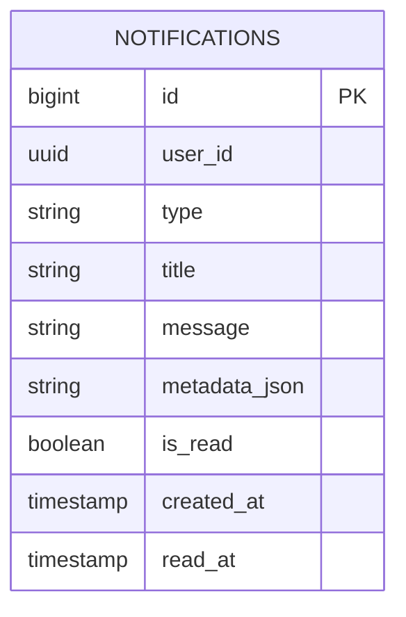

# Notification Service

[](https://www.oracle.com/java/)
[](https://spring.io/projects/spring-boot)
[](https://www.postgresql.org/)
[](https://flywaydb.org/)
[](https://kafka.apache.org/)

Multi-channel notification and alert microservice. Ingests domain events asynchronously across multiple Kafka topics, renders responsive Thymeleaf HTML transactional emails (OTP, order confirmations, status transitions), and powers the real-time in-app notification center.

---

## 1. Architectural Highlights

- **Multi-Topic Asynchronous Ingestion**:
  - `otp-events`: Dispatches 6-digit verification code emails with expiring validity.
  - `auth-events`: Sends welcome emails to new customers and notification alerts for seller approvals or rejections.
  - `order-events`: Delivers transactional order receipts and shipping milestone updates (`ORDER_CONFIRMED`, `SHIPPED`, `DELIVERED`, `CANCELLED`).
- **In-App Notification Center**:
  - Provides lightweight unread badge counter (`GET /api/v1/notifications/unread-count`) optimized for 30-second UI polling.
  - Supports individual (`PATCH /{id}/read`) and bulk read status transitions (`PATCH /read-all`).
- **Thymeleaf HTML Email Templating**:
  - Professional, mobile-responsive email templates with brand logos, order breakdown tables, and dynamic CTA buttons.
- **Database-per-Service & Flyway**:
  - Database: `ecommerce_notification_db`.
  - Versioned migration via Flyway (`V1__init_notification_schema.sql`).
  - Hibernate schema validation (`ddl-auto: validate`).

---

## 2. Database Schema (Flyway V1)



---

## 3. REST API Reference

| Method | Endpoint | Access Level | Description |
|---|---|---|---|
| `GET` | `/api/v1/notifications` | Authenticated | List user notifications (params: `unreadOnly`, `page`, `size`) |
| `GET` | `/api/v1/notifications/unread-count` | Authenticated | Fetch current unread badge count for the navbar icon |
| `PATCH` | `/api/v1/notifications/{id}/read` | Authenticated | Mark a single notification as read |
| `PATCH` | `/api/v1/notifications/read-all` | Authenticated | Bulk mark all notifications as read for current user |

---

## 4. Kafka Event Consumer Matrix

| Topic | Event Type | Action Taken |
|---|---|---|
| `otp-events` | `OTP_REQUESTED` | Renders & sends OTP email via JavaMailSender |
| `auth-events` | `USER_REGISTERED` | Renders welcome email & creates in-app notification |
| `auth-events` | `SELLER_APPROVED` | Sends seller store activation notification |
| `order-events`| `ORDER_CREATED` | Sends order invoice email with order items snapshot |
| `order-events`| `ORDER_STATUS_CHANGED`| Delivers tracking updates (e.g. `SHIPPED`, `DELIVERED`) |

---

## 5. Environment Variables & Configuration

| Variable | Default Value | Description |
|---|---|---|
| `SERVER_PORT` | `8090` | Service HTTP port |
| `POSTGRES_HOST` | `localhost` | PostgreSQL host |
| `POSTGRES_PORT` | `5432` | PostgreSQL port |
| `POSTGRES_USERNAME`| `postgres` | Database username |
| `POSTGRES_PASSWORD`| *(required)* | Database password |
| `KAFKA_BOOTSTRAP_SERVERS` | `localhost:9092` | Kafka broker connection string |
| `MAIL_HOST` | `smtp.gmail.com` | SMTP email server host |
| `MAIL_PORT` | `587` | SMTP port |
| `MAIL_USERNAME` | *(required)* | SMTP sending username / email address |
| `MAIL_PASSWORD` | *(required)* | SMTP App Password / API token |
| `MAIL_FROM` | `noreply@ecommerce.com` | From header on outgoing emails |
| `FRONTEND_URL` | `http://localhost:3000` | Frontend web application origin for email links |

---

## 6. Local Development

```bash
mvn clean spring-boot:run
```
