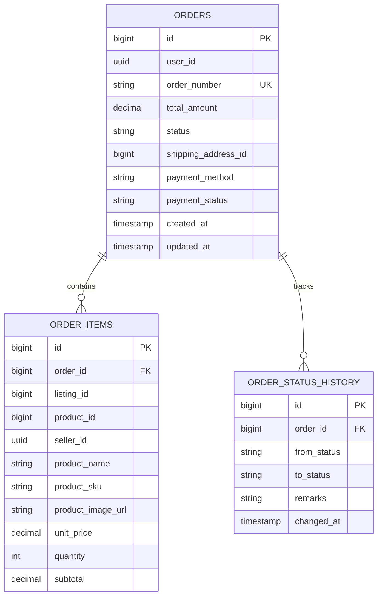

# Order Service

[](https://www.oracle.com/java/)
[](https://spring.io/projects/spring-boot)
[](https://www.postgresql.org/)
[](https://flywaydb.org/)
[](https://kafka.apache.org/)

Order lifecycle management and checkout saga orchestration microservice. Enforces checkout idempotency, coordinates atomic inventory deductions, maintains immutable item snapshots, provides multi-role order visibility (Customer, Seller, Admin), and publishes post-commit Kafka status events.

---

## 1. Architectural Highlights

- **Distributed Checkout Saga**:
  - Validates active cart items via `cart-service` (OpenFeign).
  - Verifies and deducts listing inventory via `product-service` (OpenFeign).
  - On cancellation, triggers compensating stock restoration via `product-service`.
- **Idempotency Protection**:
  - Accepts optional `Idempotency-Key` header on checkout. Duplicate requests return the original order response without double-deducting stock.
- **Historical Receipt Snapshotting**:
  - Copies `productName`, `productSku`, and `productImageUrl` directly into `order_items`. Subsequent catalog modifications never mutate past customer invoices.
- **Multi-Role RBAC Support**:
  - `ROLE_CUSTOMER`: Access personal orders and initiate cancellations.
  - `ROLE_SELLER`: Dedicated seller portal endpoint (`GET /api/v1/orders/seller`) and fulfillment status transitions (`PATCH /api/v1/orders/{id}/status`).
  - `ROLE_ADMIN`: Platform-wide order inspection and intervention.
- **Audit History**:
  - Maintains `order_status_history` tracking each state transition (`PENDING`, `CONFIRMED`, `SHIPPED`, `DELIVERED`, `CANCELLED`).

---

## 2. Database Schema (Flyway V1)



---

## 3. REST API Reference

| Method | Endpoint | Access Level | Description |
|---|---|---|---|
| `POST` | `/api/v1/orders/checkout` | Customer | Converts active cart into order (`Idempotency-Key` supported) |
| `POST` | `/api/v1/orders` | Customer | Direct order placement |
| `GET` | `/api/v1/orders` | Customer | Paginated list of customer's own orders |
| `GET` | `/api/v1/orders/{id}` | Authenticated | Retrieve comprehensive order details with items |
| `POST` | `/api/v1/orders/{id}/cancel` | Customer | Cancel order and automatically restore inventory stock |
| `GET` | `/api/v1/orders/{id}/history` | Authenticated | Audit timeline of order status transitions |
| `GET` | `/api/v1/orders/seller` | `ROLE_SELLER`, `ROLE_ADMIN` | List incoming orders containing seller's items |
| `PATCH` | `/api/v1/orders/{id}/status` | `ROLE_SELLER`, `ROLE_ADMIN` | Transition order status (`CONFIRMED`, `SHIPPED`, `DELIVERED`, `CANCELLED`) |
| `GET` | `/api/v1/orders/admin/all` | `ROLE_ADMIN` | Platform-wide order management list |
| `GET` | `/api/v1/orders/admin/{id}` | `ROLE_ADMIN` | Administrator order detail inspection |

---

## 4. Kafka Event Publishing

- **Topic**: `order-events`
- **Events**:
  - `ORDER_CREATED`: Ingested by `notification-service` to send order confirmation email.
  - `ORDER_CONFIRMED`: Ingested by `notification-service` to alert buyer and seller.
  - `ORDER_STATUS_CHANGED`: Tracking status changes (e.g. `SHIPPED`, `DELIVERED`).
  - `ORDER_CANCELLED`: Triggers refund / cancellation notifications.

---

## 5. Environment Variables & Configuration

| Variable | Default Value | Description |
|---|---|---|
| `SERVER_PORT` | `8084` | Service HTTP port |
| `POSTGRES_HOST` | `localhost` | PostgreSQL host |
| `POSTGRES_PORT` | `5432` | PostgreSQL port |
| `POSTGRES_USERNAME`| `postgres` | Database username |
| `POSTGRES_PASSWORD`| *(required)* | Database password |
| `KAFKA_BOOTSTRAP_SERVERS` | `localhost:9092` | Kafka broker connection string |
| `EUREKA_SERVER_URL` | `http://localhost:8761/eureka/` | Eureka Service Registry endpoint |

---

## 6. Local Development

```bash
mvn clean spring-boot:run
```
