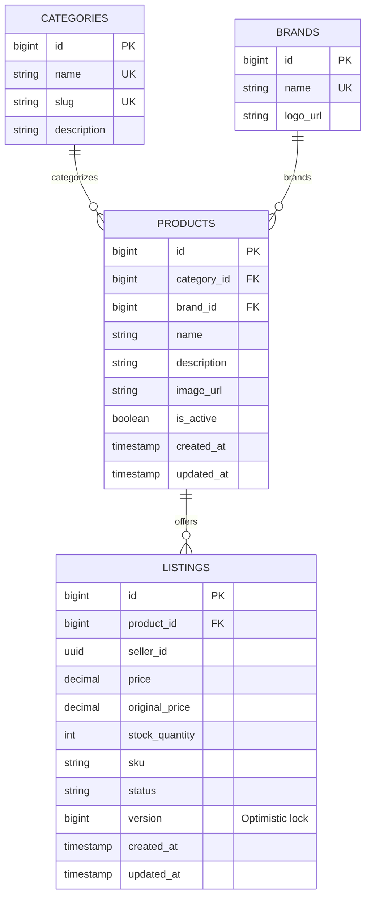

# Product Service

[](https://www.oracle.com/java/)
[](https://spring.io/projects/spring-boot)
[](https://www.postgresql.org/)
[](https://flywaydb.org/)
[](https://kafka.apache.org/)

Marketplace product catalog, brand/category taxonomy, and multi-seller inventory microservice. Features optimistic locking concurrency control for atomic stock deductions and an immutable CDN image reference architecture.

---

## 1. Architectural Highlights

- **Multi-Seller Marketplace Model**:
  - Decouples global product definitions (`products`) from seller inventory offerings (`listings`).
  - Multiple approved sellers can list competitive pricing, stock levels, and SKUs against the same master product.
- **Optimistic Concurrency Control (`@Version`)**:
  - The `Listing` entity utilizes JPA `@Version` column (`version BIGINT`) to guarantee race-condition-free stock reservations during high-volume flash sales.
- **Stock Reservation & Restoration Endpoints**:
  - Internal REST endpoints (`/deduct-stock`, `/restore-stock`) called synchronously by `order-service` during checkout and cancellation sagas.
- **Immutable CDN Image URL Architecture**:
  - Stores high-resolution CDN/S3 image URLs (`VARCHAR(2048)`) instead of raw binary BLOBs, ensuring lightweight database tables and global CDN edge caching.
- **Database-per-Service & Flyway**:
  - Database: `ecommerce_product_db`.
  - Versioned migration via Flyway (`V1__init_product_schema.sql`).
  - Hibernate schema validation (`ddl-auto: validate`).

---

## 2. Database Schema (Flyway V1)



---

## 3. REST API Reference

| Method | Endpoint | Access Level | Description |
|---|---|---|---|
| `GET` | `/api/v1/products` | Public | Paginated product search (params: `page`, `size`, `category`, `brand`, `search`) |
| `GET` | `/api/v1/products/{id}` | Public | Detailed product view including brand, category, and active listings |
| `POST` | `/api/v1/products` | `ROLE_ADMIN` | Register new master product definition |
| `PUT` | `/api/v1/products/{id}` | `ROLE_ADMIN` | Update master product metadata |
| `DELETE` | `/api/v1/products/{id}` | `ROLE_ADMIN` | Soft delete / deactivate product |
| `GET` | `/api/v1/categories` | Public | Retrieve product category taxonomy tree |
| `POST` | `/api/v1/categories` | `ROLE_ADMIN` | Create new product category |
| `GET` | `/api/v1/brands` | Public | List all manufacturer brands |
| `POST` | `/api/v1/brands` | `ROLE_ADMIN` | Register a new brand |
| `GET` | `/api/v1/listings` | Public | Query marketplace listings (filter by `productId`, `sellerId`, `status`) |
| `GET` | `/api/v1/listings/my` | `ROLE_SELLER` | List active seller's private inventory offerings |
| `POST` | `/api/v1/listings` | `ROLE_SELLER` | List inventory offer against a product |
| `PUT` | `/api/v1/listings/{id}` | `ROLE_SELLER`, `ROLE_ADMIN` | Update listing price, discount, or stock |
| `DELETE` | `/api/v1/listings/{id}` | `ROLE_SELLER`, `ROLE_ADMIN` | Deactivate/remove listing |
| `POST` | `/api/v1/listings/{id}/deduct-stock` | Internal / Order | Atomic stock deduction during checkout |
| `POST` | `/api/v1/listings/{id}/restore-stock` | Internal / Order | Atomic stock restoration upon order cancellation |

---

## 4. Kafka Event Publishing

- **Topic**: `product-events`
- **Events**:
  - `PRODUCT_CREATED`: Emitted when new catalog item is created.
  - `LISTING_CREATED`: Emitted when a seller lists inventory.
  - `STOCK_UPDATED`: Emitted when stock level changes.

---

## 5. Environment Variables & Configuration

| Variable | Default Value | Description |
|---|---|---|
| `SERVER_PORT` | `8083` | Service HTTP port |
| `POSTGRES_HOST` | `localhost` | PostgreSQL host |
| `POSTGRES_PORT` | `5432` | PostgreSQL port |
| `POSTGRES_USERNAME`| `postgres` | Database username |
| `POSTGRES_PASSWORD`| *(required)* | Database password |
| `KAFKA_BOOTSTRAP_SERVERS` | `localhost:9092` | Kafka broker connection string |
| `EUREKA_SERVER_URL` | `http://localhost:8761/eureka/` | Eureka Service Registry endpoint |

---

## 6. Local Development

```bash
mvn clean spring-boot:run
```
