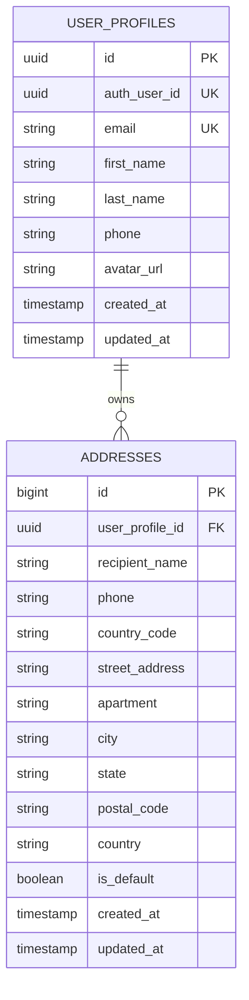

# User Service

[](https://www.oracle.com/java/)
[](https://spring.io/projects/spring-boot)
[](https://www.postgresql.org/)
[](https://flywaydb.org/)
[](https://kafka.apache.org/)

User profile and customer address lifecycle microservice. Consumes authentication events asynchronously to provision customer accounts, provides `/me` REST endpoints for client applications, and orchestrates address management with default fallback guarantees.

---

## 1. Architectural Highlights

- **Idempotent Event Consumption**:
  - Consumes `auth-events` (`USER_REGISTERED`, `SELLER_REGISTERED`) from Kafka.
  - Implements duplicate detection to safely ignore duplicate event deliveries.
- **Client-Centric Profile Endpoints (`/me`)**:
  - In addition to standard UUID routes (`/api/v1/users/{userId}`), provides `/api/v1/users/me` routes (`GET`, `PUT`, `PATCH`, `DELETE`) resolving identity from the gateway-injected `X-User-Id` header.
- **Smart Default Address Lifecycle**:
  - The first address created for a user is automatically designated as `is_default = true`.
  - Setting an address as default atomically unsets previous default flags.
  - Deleting a default address automatically promotes the next available address to default, ensuring the user always maintains a valid shipping destination for checkout.
- **Database-per-Service & Flyway**:
  - Dedicated PostgreSQL database: `ecommerce_user_db`.
  - Versioned migration via Flyway (`V1__init_user_schema.sql`).
  - Hibernate schema validation (`ddl-auto: validate`).

---

## 2. Database Schema (Flyway V1)



---

## 3. REST API Reference

| Method | Endpoint | Access Level | Description |
|---|---|---|---|
| `GET` | `/api/v1/users/me` | Authenticated | Retrieve current authenticated user's profile |
| `PUT` | `/api/v1/users/me` | Authenticated | Full profile replacement update |
| `PATCH` | `/api/v1/users/me` | Authenticated | Partial profile update (phone, names, avatar) |
| `DELETE` | `/api/v1/users/me` | Authenticated | Deactivate user account profile |
| `GET` | `/api/v1/users/{userId}` | Authenticated | Fetch profile by auth UUID (internal / admin lookup) |
| `GET` | `/api/v1/users/addresses` | Authenticated | List all shipping addresses for current user |
| `POST` | `/api/v1/users/addresses` | Authenticated | Create new address (auto-default if first) |
| `GET` | `/api/v1/users/addresses/{id}` | Authenticated | Fetch specific address by ID |
| `PUT` | `/api/v1/users/addresses/{id}` | Authenticated | Update existing address details |
| `DELETE` | `/api/v1/users/addresses/{id}` | Authenticated | Delete address with automatic fallback default promotion |
| `PATCH` | `/api/v1/users/addresses/{id}/default` | Authenticated | Mark address as primary default |

---

## 4. Kafka Event Consumer

- **Topic**: `auth-events`
- **Group ID**: `user-service-group`
- **Consumed Events**:
  - `USER_REGISTERED`: Provisions a new profile record in `user_profiles`.
  - `SELLER_REGISTERED`: Provisions a seller profile with business metadata.

---

## 5. Environment Variables & Configuration

| Variable | Default Value | Description |
|---|---|---|
| `SERVER_PORT` | `8082` | Service HTTP port |
| `POSTGRES_HOST` | `localhost` | PostgreSQL host |
| `POSTGRES_PORT` | `5432` | PostgreSQL port |
| `POSTGRES_USERNAME`| `postgres` | Database username |
| `POSTGRES_PASSWORD`| *(required)* | Database password |
| `KAFKA_BOOTSTRAP_SERVERS` | `localhost:9092` | Kafka broker connection string |
| `EUREKA_SERVER_URL` | `http://localhost:8761/eureka/` | Eureka Service Registry endpoint |

---

## 6. Local Development

```bash
mvn clean spring-boot:run
```
