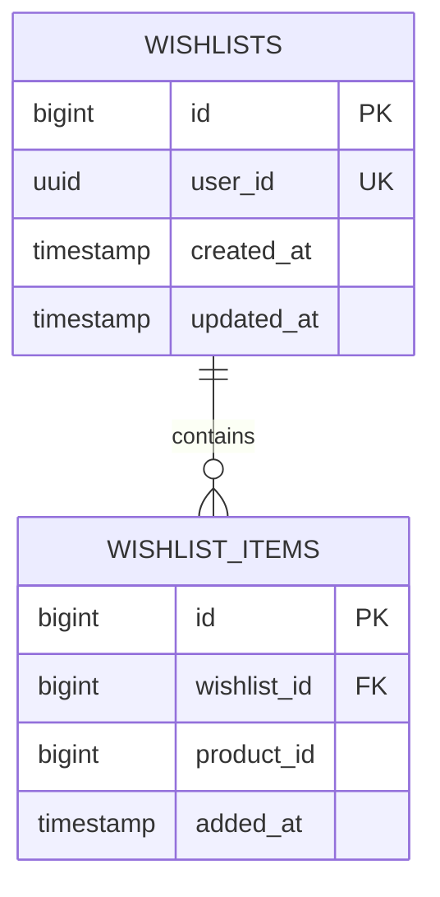

# Wishlist Service

[](https://www.oracle.com/java/)
[](https://spring.io/projects/spring-boot)
[](https://www.postgresql.org/)
[](https://flywaydb.org/)
[](https://kafka.apache.org/)

Customer saved items and wishlist microservice. Integrates with `product-service` via OpenFeign to deliver enriched saved items and provides O(1) item verification endpoints for frontend catalog card interaction.

---

## 1. Architectural Highlights

- **Dynamic Product Metadata Enrichment**:
  - Automatically enriches saved items with `productName`, `imageUrl`, and pricing metadata fetched from `product-service`.
- **High-Efficiency Check Endpoint**:
  - Provides `GET /api/v1/wishlist/items/{productId}/check` returning `{ "inWishlist": true/false }`, allowing frontend catalog cards to display active heart icons without loading full wishlist collections.
- **Bulk Clearance**:
  - Provides atomic `DELETE /api/v1/wishlist` for one-click wishlist purging.
- **Post-Commit Kafka Event Publishing**:
  - Publishes `WISHLIST_ITEM_ADDED` and `WISHLIST_ITEM_REMOVED` to Kafka topic `wishlist-events` after transaction commit.

---

## 2. Database Schema (Flyway V1)



---

## 3. REST API Reference

| Method | Endpoint | Access Level | Description |
|---|---|---|---|
| `GET` | `/api/v1/wishlist` | Authenticated | Retrieve customer's enriched wishlist items |
| `POST` | `/api/v1/wishlist/items/{productId}` | Authenticated | Add catalog product to wishlist |
| `DELETE` | `/api/v1/wishlist/items/{productId}` | Authenticated | Remove product from wishlist |
| `GET` | `/api/v1/wishlist/items/{productId}/check`| Authenticated | Check if specific product is already in user's wishlist |
| `DELETE` | `/api/v1/wishlist` | Authenticated | Purge all items from wishlist |

---

## 4. Environment Variables & Configuration

| Variable | Default Value | Description |
|---|---|---|
| `SERVER_PORT` | `8086` | Service HTTP port |
| `POSTGRES_HOST` | `localhost` | PostgreSQL host |
| `POSTGRES_PORT` | `5432` | PostgreSQL port |
| `POSTGRES_USERNAME`| `postgres` | Database username |
| `POSTGRES_PASSWORD`| *(required)* | Database password |
| `KAFKA_BOOTSTRAP_SERVERS` | `localhost:9092` | Kafka broker connection string |
| `EUREKA_SERVER_URL` | `http://localhost:8761/eureka/` | Eureka Service Registry endpoint |

---

## 5. Local Development

```bash
mvn clean spring-boot:run
```
